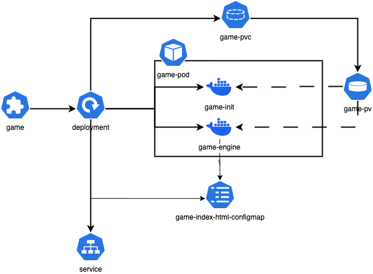
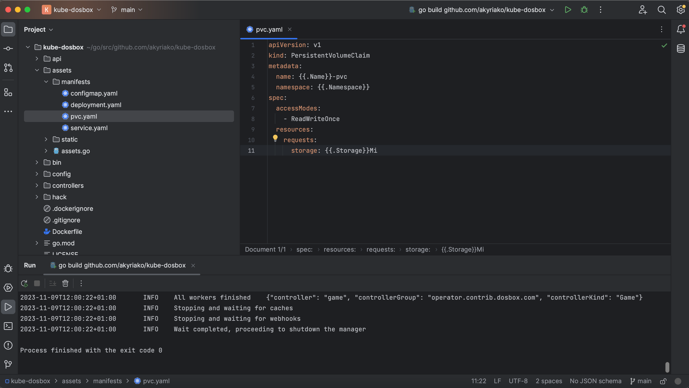
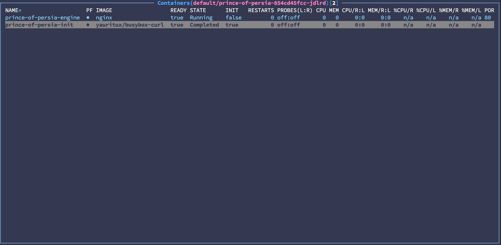
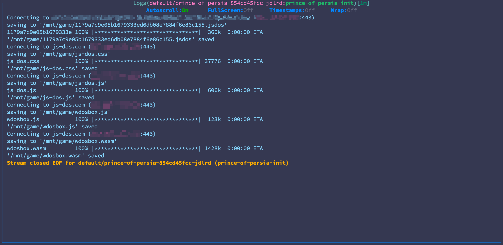
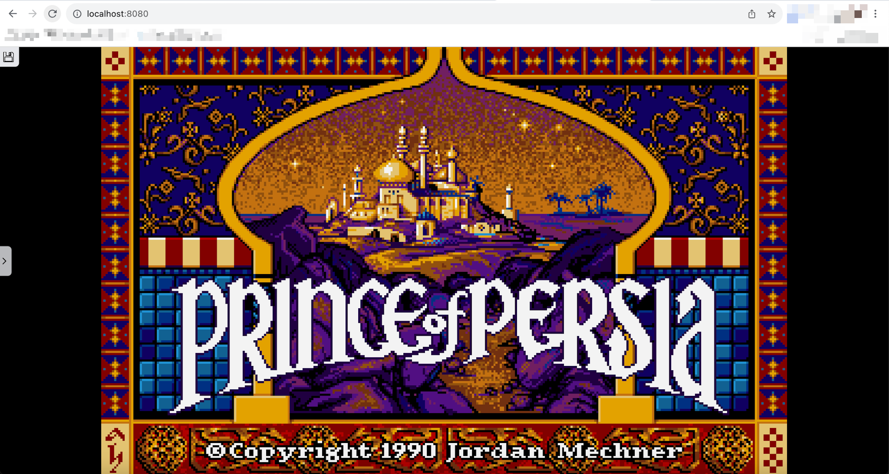

import { Aside } from 'astro-pure/user'
import { GithubCard } from 'astro-pure/advanced'

<Aside type="tip" title="TL;DR">
In this article we are going to explore how we could integrate [js-dos JavaScript library](https://github.com/caiiiycuk/js-dos) in a custom Kubernetes solution that would allow us to expose MS-DOS games as Kubernetes services and run them in a browser.

Additionally, in the course of this article we are going to exhibit and explain some novice, intermediate and advanced tips & tricks on developing Kubernetes custom controllers with [Golang](https://go.dev) and [Kubebuilder](https://github.com/kubernetes-sigs/kubebuilder) or [Operator SDK](https://sdk.operatorframework.io/).
</Aside>

## Introduction

**js-dos** is a JavaScript library that provides a full-featured DOS player that can be used to load MS-DOS programs and run them in a web-browser — it is essentially a port of the famous [DOSBOX](https://www.dosbox.com) emulator to JavaScript. js-dos is simple, yet very effective, and can be installed and used as a standard JavaScript library in many different ways: in an iframe, in nodeJS, in React or straight in a vanilla HTML page that will run in a browser. The latter one is the approach we are going to use for our solution.

**js-dos** comes with its very own distribution file format that calls it **bundle**. Bundles are nothing more than a zip files that contains a bunch of files necessary for the setup and the configuration of the emulator and the game itself; all packed nicely in a file with a `.jsdos` extension. When it comes to loading the game and the emulator on a web page now, we are going to need in addition to those, an HTML page (with very standardized content) that will load the js-dos JavaScript library, its accompanying CSS file,the game’s js-dos file and the necessary DOSBOX configuration for the game and the lastly the actual DOSBOX emulator, as WASM.

## Design & Implementation

<Aside type="note">
This article is neither a primer in building custom Kubernetes controllers nor in Golang. It requires basic knowledge of the Go language and certain level of understanding of how Kubernetes controllers and operators are working and essentially a basic experience in working with either Kubebuilder or Operator SDK.
</Aside>

The core idea is the following: ***we need a single structural entity that will point to the game bundle and let Kubernetes take care the provisioning and lifecycle of the elements required to make this game playable in a browser.***

The obvious choice is to create a [Custom Resource](https://kubernetes.io/docs/concepts/extend-kubernetes/api-extension/custom-resources/#:~:text=A%20custom%20resource%20is%20an,resources%2C%20making%20Kubernetes%20more%20modular.) (CR) and a custom controller that will take care the provisioning of those Kubernetes resources that will support its functionality. Let’s call this CR `Game`and its definition would look, in its simplest form, something like this:

```go
type GameSpec struct {

 // +kubebuilder:validation:Required
 // +kubebuilder:validation:Type=string
 GameName string `json:"gameName"`

 // +kubebuilder:validation:Required
 // +kubebuilder:validation:Pattern:=`^https?:\/\/(?:www\.)?[-a-zA-Z0-9@:%._\+~#=]{1,256}\.[a-zA-Z0-9()]{1,6}\b(?:[-a-zA-Z0-9()@:%_\+.~#?&\/=]*)$`
 Url string `json:"url"`

 // +kubebuilder:default:=false
 // +kubebuilder:validation:Required
 // +kubebuilder:validation:Type=boolean
 Deploy bool `json:"deploy"`

 // +optional
 // +kubebuilder:default=80
 // +kubebuilder:validation:Type=integer
 // +kubebuilder:validation:Minimum=1
 // +kubebuilder:validation:Maximum=65535
 // +kubebuilder:validation:ExclusiveMinimum=false
 // +kubebuilder:validation:ExclusiveMaximum=false
 Port int `json:"port,omitempty"`
}
```

A `Game`, consists of 3 mandatory and 1 optional fields: `GameName` serves obviously as a human readable title of the game, `Url` as the address where the game bundle will be downloaded from, `Deploy` as a boolean switch to install and uninstall the game and the optional `Port` as the port number that our Kubernetes service will be exposed at.

<Aside type="note">
We can use the `// +kubebuilder:validation` markers (annotations) to configure & enforce value, range or type validation either explicitly or implicitly via a regex for our API. More information [here](https://book.kubebuilder.io/reference/markers/crd-validation). That is for simple validation use cases, if you need to implement more complicated scenarios, have a look to [Admissions Webhooks](https://book.kubebuilder.io/reference/admission-webhook.html?highlight=admission#admission-webhooks) concept.
</Aside>

OK now let’s go back mentally to the introduction. We have already a structure that holds the basic information for a game. In order this game to be playable, a couple of things have to fall in the right place. We are going to need an HTML page that will load **a)** the bundle **b)** its supporting scripts & stylesheets and **c)** the DOSBOX emulator and all that will be picked up and served by a web server.

Let’s start from the bottom to unravel this one. We are going to use a simple component as a web server; and that would be an **nginx** instance, that will read a simple HTML page and publish it to port 80. The easy way to go there, is to create a **Pod** and provision in this Pod an **nginx** Container that will serve this page.

***But how are we going to provision this HTML page (configured individually per game) to Kubernetes and let nginx container to pick it up?*** The answer is simple: with a **ConfigMap,** that we’re later going to mount on the nginx Container as a **Volume**:

```yaml
apiVersion: v1
kind: ConfigMap
metadata:
  name: {{.Name}}-index-configmap
  namespace: {{.Namespace}}
data:
  index.html: |
    <!doctype html>
    <html>
    <head>
        <meta name="viewport" content="width=device-width, initial-scale=1.0, maximum-scale=1.0, user-scalable=no"/>
        <style>
            html, body, #jsdos {
                width: 100%;
                height: 100%;
                margin: 0;
                padding: 0;
            }
        </style>
        <script src="js-dos.js"></script>
        <link href="js-dos.css" rel="stylesheet">
    </head>
    <body>
    <div id="jsdos"/>
    <script>
        emulators.pathPrefix = "/";
        Dos(document.getElementById("jsdos"))
            .run("{{.Bundle}}");
    </script>
    </body>
    </html>
```

In the `data` section of the ConfigMap we will provide a key call `index.html` and its value will be a **template** version of the HTML page that will be responsible of loading the necessary artefacts for each game.

<Aside type="note">
Why this manifest — and the ones that will follow — are templates and how we are going to use them, is a thing we are going to explain later in this article.
</Aside>

But here we have a problem! As we mentioned above: “*the HTML page that will be responsible of loading the necessary artefacts for each game*” (like **js-dos.js**, **jsdos.css** and the templated value of the bundle url .

***Where are we going to find actually those files?*** We need to download these files and place them in the Volume, so they are available to the nginx web server the first time someone tries to load the page. In order to accomplish that, we are going to provision a **second** **container** in our Pod, but this one is going to have a major difference from the previous one: it is going to be an init container.

<Aside type="note">
Init Containers are special containers that run **before** other containers in a Pod. Init containers can contain utilities or setup scripts not present in the main container and help us download files, load or reload configuration etc.
</Aside>

For that matter — we still want to keep it simple — we are going to use [busybox](https://busybox.net) as the image of the init container and instruct it to run a single `wget` command, that will download all the artefacts we need and save them in the same folder that we are going to hold our HTML page. That essentially means that we need to mount the volume we mounted on the nginx container, on the init container as well.

```bash
wget -P "/mnt/game" --no-check-certificate \ 
{{.BundleUrl}} \
https://js-dos.com/v7/build/releases/latest/js-dos/js-dos.css \
https://js-dos.com/v7/build/releases/latest/js-dos/js-dos.js \
https://js-dos.com/v7/build/releases/latest/js-dos/wdosbox.js \
https://js-dos.com/v7/build/releases/latest/js-dos/wdosbox.wasm
```

But you will rightfully think now: ***Hold on, what about the Volume, who and how is going to provision a Volume?*** For the HTML content of our nginx container the answer is simple: a **ConfigMap** can be mounted as volume on a container, but for those artefacts downloaded by the init container and used by the nginx container, we need to provision a [**PersistentVolumeClaim**](https://kubernetes.io/docs/concepts/storage/persistent-volumes/) (PVC):

```yaml
apiVersion: v1
kind: PersistentVolumeClaim
metadata:
  name: {{.Name}}-pvc
  namespace: {{.Namespace}}
spec:
  accessModes:
    - ReadWriteOnce
  resources:
    requests:
      storage: {{.Storage}}Mi
```

<Aside type="note">
A *PersistentVolumeClaim* (PVC) is an abstract request for storage by a user. It is similar to a Pod. Pods consume node resources and PVCs consume Persistent Volume (PV) resources. Pods can request specific levels of resources (CPU and Memory). Claims can request specific size and access modes (e.g., they can be mounted as ReadWriteOnce, ReadOnlyMany or ReadWriteMany).
</Aside>

The PVC is an abstract request for storage; the first time a Pod will bound to PVC (in our case first in line is the init container) the underlying storage driver will automatically create a PersistentVolume which will be eventually attach to the container(s) without any required action by our side.

So far so good, but you might now wonder: ***This is thing is getting a bit messy, can we please pack them up nicely somehow?*** The answer is yes, and for that matter we are going to create a **Deployment** that will own and provision all these resources on our behalf:

```yaml
apiVersion: apps/v1
kind: Deployment
metadata:
  name: {{.Name}}
  namespace: {{.Namespace}}
  labels:
    app: {{.Name}}
spec:
  replicas: 1
  selector:
    matchLabels:
      app: {{.Name}}
  template:
    metadata:
      name: {{.Name}}
      labels:
        app: {{.Name}}
    spec:
      volumes:
        - name: {{.Name}}-storage
          persistentVolumeClaim:
            claimName: {{.Name}}-pvc
        - name: {{.Name}}-index
          configMap:
            name: {{.Name}}-index-configmap
      containers:
        - name: {{.Name}}-engine
          image: nginx
          imagePullPolicy: IfNotPresent
          ports:
            - containerPort: 80
          volumeMounts:
            - mountPath: /usr/share/nginx/html
              name: {{.Name}}-storage
            - mountPath: /usr/share/nginx/html/index.html
              subPath: index.html
              name: {{.Name}}-index
      initContainers:
        - name: {{.Name}}-init
          image: busybox:1.28
          imagePullPolicy: IfNotPresent
          command: [ "sh" ]
          args:
            - -c
            - >-
                wget -P "/mnt/game" --no-check-certificate {{.BundleUrl}} https://js-dos.com/v7/build/releases/latest/js-dos/js-dos.css https://js-dos.com/v7/build/releases/latest/js-dos/js-dos.js https://js-dos.com/v7/build/releases/latest/js-dos/wdosbox.js https://js-dos.com/v7/build/releases/latest/js-dos/wdosbox.wasm;
          volumeMounts:
            - mountPath: /mnt/game
              name: {{.Name}}-storage
      restartPolicy: Always
```



If you check the `spec.volumes`, you will now clearly see how we instructed the creation of two volumes, one from a ConfigMap and one from a PVC. The one originating from the PVC is mounted on both containers (check `volumeMounts` under `containers` and `initContainers`). When it comes to the nginx container there is a subtle intricacy, that practically is the glue that makes this think work: *Both* volumes are mounted under the same path in the nginx container, where the web server will pick up the HTML page `index.html`.

```yaml
volumeMounts:
  - mountPath: /usr/share/nginx/html
      name: {{.Name}}-storage
  - mountPath: /usr/share/nginx/html/index.html
      subPath: index.html
      name: {{.Name}}-index
```

Last step is of course being able to access the nginx container out of the borders of Kubernetes, so we can render the HTML page in our browser and eventually play our game. For that reason, we are going to provision a [**Service**](https://kubernetes.io/docs/concepts/services-networking/service/):

```yaml
apiVersion: v1
kind: Service
metadata:
  name: {{.Name}}
  namespace: {{.Namespace}}
spec:
  selector:
    app: {{.Name}}
  ports:
    - protocol: TCP
      port: {{.Port}}
      targetPort: 80
  type: ClusterIP
```

## Building the Controller

One main driver behind the development of the controller is to make a lightweight controller that do not create unnecessary “noise” in the cluster, as we can potentially load **a quite big number** of `Games` — currently nearly **2000 games** are offered in [dos.zone](https://dos.zone), a js-dos community project.

In order to minimize unnecessary reconciliations loops, we are going to play with the so-called *Event Filters* while setting up our controller in order to filter which create/update/delete/generic events eventually trigger reconciliations. A given predicate is added to the watch object, that regulates when and if it will lead to calling a reconciliation request:

```go
var (
 gameEventFilters = builder.WithPredicates(predicate.Funcs{
  UpdateFunc: func(e event.UpdateEvent) bool {
   return e.ObjectOld.GetGeneration() != e.ObjectNew.GetGeneration()
  },
  DeleteFunc: func(e event.DeleteEvent) bool {
   return !e.DeleteStateUnknown
  },
  CreateFunc: func(e event.CreateEvent) bool {
   switch object := e.Object.(type) {
   case *operatorv1alpha1.Game:
    return object.Spec.Deploy
   default:
    return false
   }
  },
 })
)

func (r *GameReconciler) SetupWithManager(mgr ctrl.Manager) error {
 return ctrl.NewControllerManagedBy(mgr).
  For(&operatorv1alpha1.Game{}, gameEventFilters).
 Complete(r)
}
```

We have the chance to control via 4 predicate functions the respective distinct events: `GenericFunc`(here is omitted), `CreateFunc`, `UpdateFunc` and `DeleteFunc`. You will notice that we let a reconciliation to happen during an *Update* event only when there is a change in the actual `specs` of the `Game` and not when a `status` update is occurring by comparing whether the `ObjectOld` and `ObjectNew` values are semantically equal:

```go
UpdateFunc: func(e event.UpdateEvent) bool {
   return e.ObjectOld.GetGeneration() != e.ObjectNew.GetGeneration()
}
```

We mute completely the *Delete* events. As long as the `Game` is deleted we don’t want/need to update something in our cluster. `DeleteStateUnknown` evaluates to `false` only if the object has been confirmed as deleted by the API server:

```go
DeleteFunc: func(e event.DeleteEvent) bool {
   return !e.DeleteStateUnknown
}
```

Lastly, during a *Create* event we let a reconciliation to get started only if the CR that triggered the event is a `Game` and only if the value of its `Spec.deploy` field is `true`.

```go
CreateFunc: func(e event.CreateEvent) bool {
   switch object := e.Object.(type) {
   case *operatorv1alpha1.Game:
    return object.Spec.Deploy
   default:
    return false
   }
}
```

The reason is dual: **a)** A `Game` **owns** the other resources we discussed in the previous paragraph (the `Deployment`; and Deployment in its turn owns the `Pod`, `ConfigMap`, `PVC`,`PV` and `Service` — if we delete a `Game` we want all those resources to be deleted automatically). If in the future we want to watch another of those resources we should be able to figure out the originator of the events. **b)** as mentioned before, there can be potentially a massive number of `Games` that might be created in bulk. If they simultaneously trigger a reconciliation they will put the cluster under enormous pressure, so we make sure that only newly created Games that their `Spec.Deploy` is set as true will trigger a reconciliation during a *Create* event.

Now let’s dive in the functionality of the reconciliation loop:

```go
func (r *GameReconciler) Reconcile(ctx context.Context, req ctrl.Request) (ctrl.Result, error) {
 logger = log.FromContext(ctx).WithName("controller")

 game := &operatorv1alpha1.Game{}
 if err := r.Get(ctx, req.NamespacedName, game); err != nil {
  if apierrors.IsNotFound(err) {
   return ctrl.Result{}, nil
  }

  logger.V(5).Error(err, "unable to fetch game")
  return ctrl.Result{}, err
 }

 if !game.Spec.Deploy {
  err := r.DeleteDeployment(ctx, req, game)
  if err != nil {
   return ctrl.Result{}, err
  }

  _ = r.SetStatus(ctx, req, game, false)
  return ctrl.Result{}, nil
 }

 deployment, err := r.CreateOrUpdateDeployment(ctx, req, game)
 if err != nil {
  return ctrl.Result{}, err
 }

 _, err = r.CreateOrUpdateConfigMap(ctx, req, game, deployment)
 if err != nil {
  return ctrl.Result{}, err
 }

 _, err = r.CreateOrUpdatePersistentVolumeClaim(ctx, req, game, deployment)
 if err != nil {
  return ctrl.Result{}, err
 }

 _, err = r.CreateOrUpdateService(ctx, req, game, deployment)
 if err != nil {
  return ctrl.Result{}, err
 }

 return r.RefreshStatus(ctx, req, game, deployment.Labels["app"])
}
```

The goal of function `Reconcile` is to manage the resource `Game`. If `Spec.Deploy` is `false` then all the provisioned resources should be deleted — if was prior installed — and when the `Spec.Deploy` is set to `true` to provision all the necessary artefacts in an idempotent way.

Every `CreateOrUpdateXXX` function does two simple interdependent tasks:

**a)** creates a concrete manifest for its corresponding resource:

We do have the option actually to create all these Kubernetes resources by using exclusively Golang and no manifest templates, but in my opinion and taste that tends to be harder to read, harder to maintain and change and eventually more error prone in the long term.

An alternative is to create a scaffold of the manifests in a template format that we could be able to parse in a Golang idiomatic way via the `text/template` package. For that matter I have saved all those YAML templates in a separate folder i call `manifests`. I ‘ve created an `assets` package that uses the `embed` package to get a reference to the contents of manifests.

```go
//go:embed manifests/*
 manifests embed.FS
```



Every single template’s contents are read from the function called `getTemplate` via `manifests.ReadFile` (remember here `manifests` are an `embed.FS`) and from the parsed contents return a template to the caller:

```go
func getTemplate(name string) (*template.Template, error) {
 manifestBytes, err := manifests.ReadFile(fmt.Sprintf("manifests/%s.yaml", name))
 if err != nil {
  return nil, err
 }

 tmp := template.New(name)
 parse, err := tmp.Parse(string(manifestBytes))
 if err != nil {
  return nil, err
 }

 return parse, nil
}
```

and calls the `getObject` function that after replacing the template placeholders with the values of the anonymous `struct`, it marshals the produced manifest to a Golang object that the API server will recognize.

```go
func getObject(name string, gv schema.GroupVersion, metadata any) (runtime.Object, error) {
 parse, err := getTemplate(name)
 if err != nil {
  return nil, err
 }

 var buffer bytes.Buffer
 err = parse.Execute(&buffer, metadata)
 if err != nil {
  return nil, err
 }

 object, err := runtime.Decode(
  appsCodecs.UniversalDecoder(gv),
  buffer.Bytes(),
 )

 return object, nil
}
```

**b)** deploys this resource:

With the right object now in our disposal, every `CreateOrUpdateXXX` function can now create the resource in Kubernetes (and set the appropriate owner of this resource with `SetControllerReference`):

```go
deployment, err = assets.GetDeployment(game.Namespace, game.Name, game.Spec.Port, game.Spec.Url)
  if err != nil {
   logger.Error(err, "unable to parse deployment template")
   return nil, err
  }

  err = ctrl.SetControllerReference(game, deployment, r.Scheme)
  if err != nil {
   logger.Error(err, "unable to set controller reference")
   return nil, err
  }

  err = r.Create(ctx, deployment)
  if err != nil {
   logger.Error(err, "unable to create deployment")
   return nil, err
  }
```



While waiting for the resources to be deployed and the init container to finish, the controller periodically probe its status (every 15sec). As long as the Pods status is ready the reconciliation loop is exiting and waits only for external events (Create, Update or Delete) that might trigger it in the future.

```go
func (r *GameReconciler) RefreshStatus(
 ctx context.Context,
 req ctrl.Request,
 game *operatorv1alpha1.Game,
 appLabel string,
) (ctrl.Result, error) {
 ready, err := r.GetStatus(ctx, req, appLabel)
 if err != nil {
  logger.V(5).Error(err, "unable to fetch pod status")

  _ = r.SetStatus(ctx, req, game, false)

  return ctrl.Result{
   Requeue:      true,
   RequeueAfter: 15 * time.Second,
  }, err
 }

 if !ready {
  logger.Info("pod not ready, requeue in 15sec")

  _ = r.SetStatus(ctx, req, game, ready)

  return ctrl.Result{
   Requeue:      true,
   RequeueAfter: 15 * time.Second,
  }, nil
 }

 err = r.SetStatus(ctx, req, game, ready)
 if err != nil {
  return ctrl.Result{
   Requeue:      true,
   RequeueAfter: 15 * time.Second,
  }, nil
 }

 return ctrl.Result{}, nil
}
```



After Deployment and Pods come in place, the init container is downloading all the files and saves them in the PV.

Let’s take it for a spin and deploy this manifest that will install [Prince of Persia](https://en.wikipedia.org/wiki/Prince_of_Persia) in your cluster:

```yaml
apiVersion: operator.contrib.dosbox.com/v1alpha1
kind: Game
metadata:
  name: prince-of-persia
spec:
  gameName: "Prince of Persia"
  url: "https://cdn.dos.zone/original/2X/1/1179a7c9e05b1679333ed6db08e7884f6e86c155.jsdos"
  deploy: true
```

As long as its finished deploying, we are ready to port-forward the Service and check it in our browser (I chose port 8080 — it is irrelevant which port you are going to choose to forward):



I guess you will spend a couple of minutes playing the first level of Prince of Persia before you come back for the epilogue. Be careful of those spikes. No rush, I can wait!

## Future work

This mini-project is far from being complete. Basic functionality is still missing like: saving your progress in the PV, publish metrics to Prometheus, publish Events to Kubernetes, update status Conditions for the CR, set resource limits for the containers and many more. Nevertheless give it a try it and you will have plenty of fun with those retro games or fork the repo and drive it to your own direction:

<GithubCard repo='akyriako/kube-dosbox' />

{/* Originally published on [Medium](https://medium.com/@akyriako/build-an-ms-dos-games-emulator-on-kubernetes-146ba6f142d9) */}
