import { Aside } from 'astro-pure/user'
import { GithubCard } from 'astro-pure/advanced'

<Aside type="tip" title="TL;DR">
Build a Kubernetes-native OpenStack cloud in under an hour using Proxmox, K3s, Ceph and OpenStack-Helm.

Instead of manually assembling every [OpenStack](https://www.openstack.org/) moving part, we use a bunch of automation scripts to built around [K3s](https://k3s.io/), [Rook-Ceph](https://rook.io/), and [OpenStack-Helm](https://github.com/openstack/openstack-helm) in order to deploy a fully functional OpenStack environment on a three-node Kubernetes cluster. Starting from a handful of virtual machines, we will bootstrap Kubernetes, provision distributed storage, prepare the networking stack, and deploy the OpenStack control plane and compute services with a series of repeatable, idempotent, scripted steps.
 
The result is not a toy deployment (not a production deployment though) or a collection of isolated services. By the end of the process, you will have a working OpenStack cloud with Keystone, Glance, Nova, Neutron, Cinder, Heat, Horizon, and Skyline running on Kubernetes, backed by Ceph storage and ready to launch networks & virtual machines for your homelab or your OpenStack development environment.
</Aside>

## Prerequisites

Before we begin, it is worth noting that **this deployment is intentionally and inevitably opinionated, due to nature and complexity of the objective**. Deploying OpenStack on Kubernetes involves a considerable number of moving parts, and the choices made throughout this guide reflect a specific approach that prioritizes simplicity, repeatability, and automation. That said, **the underlying concepts are not tied to a particular environment**. While the examples use Proxmox and OPNsense, the same deployment can be adapted to other virtualization and networking platforms, provided that the required infrastructure, networking, and storage and load-balancing capabilities are provided.

Throughout this article, it’s assumed that a virtualization and networking foundation is already in place. For that matter, [Proxmox](https://www.proxmox.com/) provides the compute layer used to host the Kubernetes nodes, while [OPNsense](https://opnsense.org/) is responsible for network services such as DNS, load balancing, and virtual IP management. These components are treated as existing infrastructure and their installation and configuration are therefore **outside the scope** of this article.

So this is what you are going to need:

- a **Proxmox** cluster (>= 8.4.2) with enough capacity to host 3 additional VMs (6 vCPUs, 16GB RAM, 2 NICs, 2 iSCSI disks) that will serve as Kubernetes nodes
- an **OPNSense** instance (≥= 25.1.12) supporting the SDN/Zone/VNet functionality of the Proxmox cluster and its VMs or LXCs
- an SDN VXLAN **Zone** and a tagged VLAN-Aware **VNet** in Proxmox. Throughout the remainder of this article, these resources will be referred to as `ixzone` and `ixvnet`, respectively.
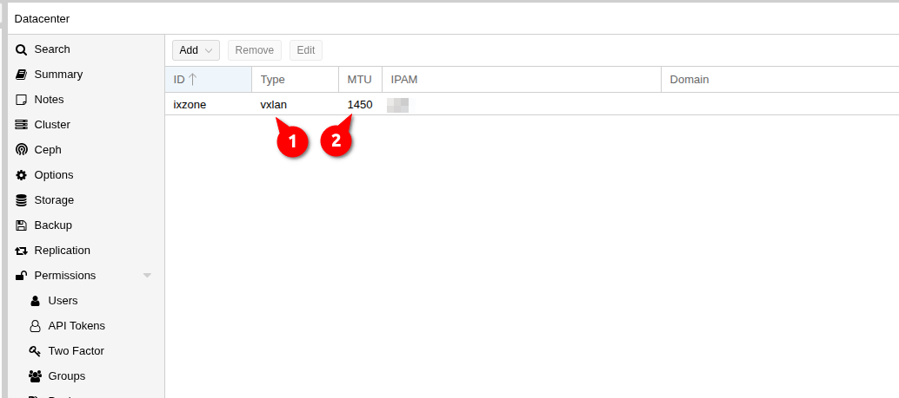

  Creating the Proxmox SDN VXLAN zone (**ixzone**). The VXLAN zone is configured with an MTU of **1450** to accommodate encapsulation overhead and serves as the network foundation for tenant connectivity within the OpenStack environment.

- **two interfaces** are configured in OPNsense. The first is attached to the untagged network and serves as the Kubernetes management network. The second is attached to VLAN 70 and provides connectivity for OpenStack external networks, including floating IP traffic. The configuration is shown in the screenshots below:


 OPNsense interface assignments used by the OpenStack deployment. The untagged physical interface **vtnet1** (1) is assigned as the Kubernetes management network, while the VLAN interface **vlan0.70** (2), created on top of **vtnet1** and configured with VLAN tag **70** (3), is dedicated to OpenStack external networking and floating IP traffic.


 VLAN configuration in OPNsense showing the **vlan0.70** interface attached to the **vtnet1** parent interface and configured with VLAN tag **70**. This VLAN provides the network segment used by OpenStack external networking, enabling connectivity for provider networks and floating IP traffic.

Before proceeding, clone the deployment repository to the node (the one destined to be the master node of your K3s cluster) that will be used to orchestrate the installation. All automation scripts, configuration templates, and deployment assets referenced throughout this article are contained in the repository:

<GithubCard repo='akyriako/osh' />

```bash
git clone https://github.com/akyriako/osh.git
cd osh
```
<Aside type="caution">
Unless stated otherwise, all commands shown in the remainder of this guide are executed from within the cloned repository directory.
</Aside>

## Architecture

At the end of this deployment, we will have a fully functional OpenStack cloud running entirely on top of a three-node [K3s](https://k3s.io/) cluster.

The Kubernetes layer forms the foundation of the platform. A single control-plane node and two worker nodes host all OpenStack services as Kubernetes workloads, deployed through OpenStack-Helm. Rather than dedicating individual virtual or physical machines to specific OpenStack roles, the control plane, networking services, storage services, and compute components are distributed across the cluster and managed through Kubernetes scheduling.


 **Target architecture**: a three-node K3s cluster running containerized OpenStack services, backed by a distributed Ceph storage cluster and exposed through OPNsense-managed ingress, DNS, and load balancing.

Persistent storage is provided by a Rook-managed Ceph cluster running on the same nodes. Each virtual machine contributes local storage devices to Ceph, creating a shared storage backend that is consumed both by Kubernetes and OpenStack services such as Cinder and Glance. This removes the need for an external storage appliance while still providing a distributed and resilient storage layer.

At the edge of the environment, OPNsense acts as the networking entry point. [HAProxy](https://github.com/haproxy/haproxy) distributes incoming traffic across the Kubernetes cluster, while DNS records resolve OpenStack service endpoints to virtual IP addresses managed by [OPNsense Unbound DNS](https://docs.opnsense.org/manual/unbound.html) service.

Two ingress paths are used within the cluster. NGINX Ingress exposes public OpenStack endpoints such as Horizon, Skyline, and Keystone, while Traefik (ingress controller that comes bundled with K3s) is retained for management interfaces and supporting services. This separation keeps administrative traffic distinct from the OpenStack APIs consumed by users and applications.

The OpenStack control plane itself consists of [Keystone](https://www.openstack.org/software/releases/dalmatian/components/keystone) for identity management, [Glance](https://www.openstack.org/software/releases/dalmatian/components/glance) for image services, [Cinder](https://www.openstack.org/software/releases/dalmatian/components/cinder) for block storage, [Heat](https://www.openstack.org/software/releases/dalmatian/components/heat) for orchestration, [Horizon](https://www.openstack.org/software/releases/dalmatian/components/horizon) and [Skyline](https://www.openstack.org/software/releases/dalmatian/components/skyline) as UI layer, and the [Nova](https://www.openstack.org/software/releases/dalmatian/components/nova), [Neutron](https://www.openstack.org/software/releases/dalmatian/components/neutron), and [Placement](https://www.openstack.org/software/releases/dalmatian/components/placement) services required to provision and operate virtual machines. Open vSwitch provides the networking foundation for tenant connectivity, while libvirt and KVM enable Nova virtual machine instances to run directly on the Kubernetes nodes.

## Prepare the Proxmox Virtual Machines

Each node has to be provisioned with **two virtual network interfaces**. The first interface is attached to the VXLAN-backed management network (`ixvnet`) and is used for Kubernetes, Ceph, and OpenStack internal communication. The second interface is connected to the same virtual network but carries VLAN tag `70`, providing access to the external provider network that Neutron later exposes as the `public` physical network.


 Proxmox virtual machine configuration used for the Kubernetes nodes that host OpenStack.

The storage configuration includes **two virtual disks**. The primary disk hosts the operating system and Kubernetes workloads, while the secondary disk is dedicated exclusively to Ceph. During the Ceph installation phase, this disk is discovered as `/dev/sdb` and consumed by Rook to create an Object Storage Daemon (OSD), contributing storage capacity to the distributed Ceph cluster.

## Install K3s Control Plane and Workers

The first step is to establish the Kubernetes cluster that will host the entire OpenStack deployment. Since [OpenStack-Helm](https://github.com/openstack/openstack-helm) packages OpenStack services as Helm charts, a functioning Kubernetes environment must be in place before any OpenStack components can be deployed.

The `install-k3s.sh` script bootstraps the cluster by installing K3s on the control-plane node and preparing it for the addition of worker nodes. During this phase, it installs and configures K3s, prepares cluster access, installs the tooling required throughout the remainder of the deployment, and exposes the default Traefik ingress controller (ingress for non-OpenStack workloads) on `HTTP/8080` and `HTTPS/8443`.

<Aside type="note">
K3s was chosen because it provides a fully conformant Kubernetes distribution while keeping the operational footprint small, making it well suited for lab environments and proof-of-concept deployments.
</Aside>

```bash
sudo ./scripts/install-k3s.sh
```

Once the control-plane installation is complete, the script generates a ready-to-use worker join-command. This command contains the information required for additional **worker** nodes to securely join the cluster and **must be executed on each worker node**.

<Aside type="note">
After running the join-command on each worker node and confirming that all nodes are part of the cluster, only then you are clear to move on to the next phase of the deployment.
</Aside>

## Post-Installation Steps for K3s Nodes

With the Kubernetes cluster in place, there is one more preparatory step before we start deploying storage and OpenStack services. While K3s can run perfectly well with its default operating system settings, OpenStack and Ceph place considerably higher demands on the underlying nodes. As the number of pods, files, watches, and network connections grows, the default kernel and system limits that are perfectly acceptable for a small Kubernetes cluster can become restrictive for a cloud platform.

The `post-k3s.sh` script prepares each node for the workload that will follow. It applies a number of operating system and Kubernetes tuning parameters, including disabling swap and increasing file descriptor and inotify limits. These changes help ensure that Kubernetes, containerd, Ceph, and the OpenStack services have sufficient resources available as the environment grows.

```bash
sudo ./scripts/post-k3s.sh
```
<Aside type="caution">
Run this script **on every node** in the cluster, including both the control-plane and worker nodes. Although the changes are relatively small, they establish a more suitable baseline for the storage and virtualization workloads that will be introduced in the next phases of the deployment.
</Aside>

## Prepare OPNsense HAProxy and Unbound DNS

Before deploying storage and OpenStack services, we need to establish how users and applications will reach them. In a public cloud providers, this responsibility is typically handled by managed load balancers and DNS services. In our environment, those capabilities are provided by OPNsense through a combination of [Virtual IP addresses](https://docs.opnsense.org/manual/firewall_vip.html), [DNS records](https://docs.opnsense.org/manual/unbound.html#overrides), and HAProxy listeners.

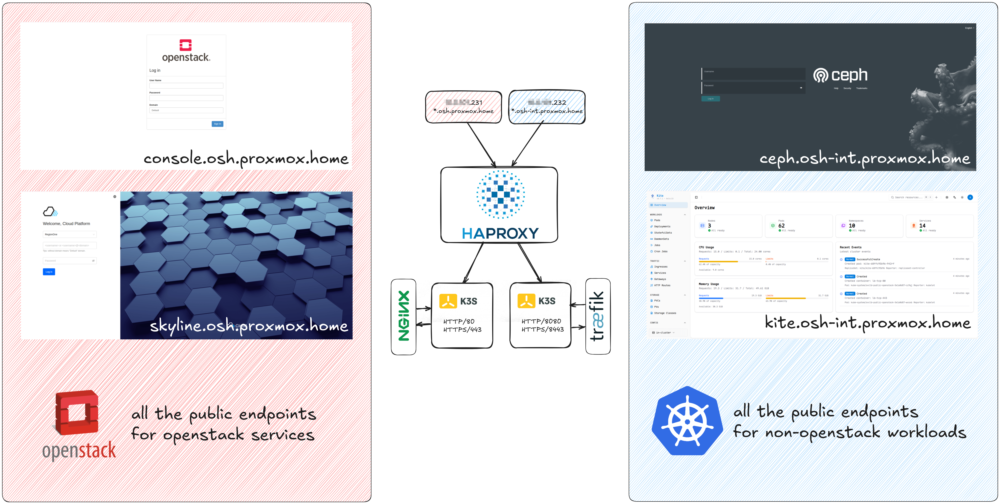

1️⃣ The first step is to create two Virtual IP addresses that will act as stable entry points into the Kubernetes cluster. One is reserved for the NGINX ingress controller that will later expose the public OpenStack endpoints, while the other is used by Traefik, which provides access to cluster management and supporting services.

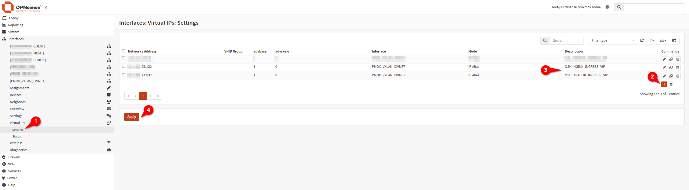

2️⃣ Unbound DNS overrides are then configured so that requests for the OpenStack and management domains resolve to the appropriate Virtual IPs. This gives us predictable hostnames from the very beginning of the deployment and avoids having to track individual Kubernetes node addresses as services move around the cluster.

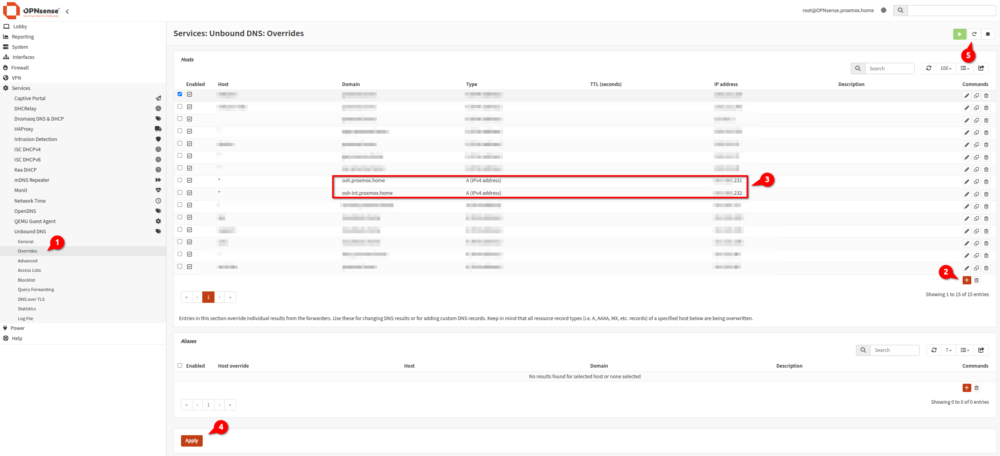

3️⃣ Finally, HAProxy has to be configured to distribute incoming traffic across all Kubernetes nodes. Rather than directing requests to a specific machine, HAProxy forwards them to whichever node is currently capable of serving the requested ingress traffic. This creates a single, consistent access layer in front of the cluster and allows the ingress controllers to remain highly available even if individual nodes become unavailable.

First we need to create the **Real Servers**:

- Navigate to **Services → HAProxy**.
- Open the **Real Servers** configuration page.
- Create a total of **12 server definitions**, 4 for each Kubernetes node.
- The first group represents the NGINX ingress endpoints (`80` and `443`).
- The second group represents the Traefik ingress endpoints (`8080` and `8443`).
- Apply the configuration before proceeding with the creation of backend pools and public listeners.


 Creating the HAProxy real server definitions used to forward ingress traffic to the Kubernetes cluster. Each node is registered multiple times, once for every ingress endpoint exposed by the cluster: HTTP (80) and HTTPS (443) for the NGINX ingress controller, and HTTP (8080) and HTTPS (8443) for Traefik. These backend definitions are later grouped into HAProxy pools and exposed through dedicated virtual IP addresses.

Next we need to create the **Backend Pools**:

- Navigate to **Services → HAProxy**.
- Open **Virtual Services → Backend Pools**.
- Create a total of **4 backend pools**.
- Add the corresponding server entries for all three Kubernetes nodes to each pool (the ones we created in the previous step).
- The resulting pools represent the NGINX (`80`, `443`) and Traefik (`8080`, `8443`) ingress endpoints.
- Apply the configuration before proceeding with the creation of public services.


 Creating the HAProxy backend pools that aggregate the ingress endpoints of all Kubernetes nodes. Four pools are defined: two for the NGINX ingress controller (`80` and `443`) and two for Traefik (`8080` and `8443`). Each pool contains the corresponding server definitions from every cluster node, allowing HAProxy to distribute traffic across the cluster rather than targeting a single host.

Last we need to create the **Public Services**:

- Navigate to **Services → HAProxy**.
- Open **Virtual Services → Public Services**.
- Configure the listener to bind to the appropriate virtual IP address and port.
- Associate the listener with the corresponding backend pool.
- Create a total of **4 public services**: two for the NGINX ingress VIP and two for the Traefik ingress VIP.
- Apply the configuration to activate the listeners.


 Creating the HAProxy public services that expose the Kubernetes ingress controllers through dedicated virtual IP addresses. Each public service binds a virtual IP and port combination to one of the backend pools created previously, providing a stable entry point for traffic entering the cluster. Two listeners are configured for the NGINX ingress controller (`80` and `443`) and two for Traefik (`80` and `443`), each mapped to their respective backend pools.

## Install Ceph

With Kubernetes deployed and external access to the cluster established through HAProxy, DNS, and ingress controllers, the next component we need is storage. OpenStack services generate and consume persistent data from the very beginning of the deployment, whether it is virtual machine images, block volumes, databases, or service metadata. Rather than relying on local node storage, we will build a distributed storage layer that is shared across the entire cluster.

To achieve this, the `install-ceph.sh` script deploys a Rook-managed Ceph cluster on Kubernetes. Each node (Proxmox virtual machine) contributes a dedicated storage device, exposed to the virtual machine as a raw disk and attached as `/dev/sdb`. These disks are used **exclusively** by Ceph to create Object Storage Daemons (OSDs), which form the foundation of the distributed storage cluster.

```bash
sudo ./scripts/install-ceph.sh
```

That will create:

✅ a Ceph deployment (1 manager, 3 monitors, 3 OSDs on `/dev/sdb` on each VM)  
✅ a`CephCluster` named `ceph`, and a `CephBlockPool` named `rdb`  
✅ a`StorageClass` named `general` based on provisioner `rook-ceph.rbd.csi.ceph.com`  
✅ the Ceph management web interface (via Traefik ingress)

Rook takes care of deploying and managing the Ceph components inside Kubernetes, while Ceph itself provides the resilient block storage backend consumed by both Kubernetes and OpenStack. As part of the installation, the script creates the Ceph cluster, provisions the OSDs on the dedicated disks, creates an RBD pool, and exposes a Kubernetes `StorageClass` that will later be used by OpenStack-Helm itself.

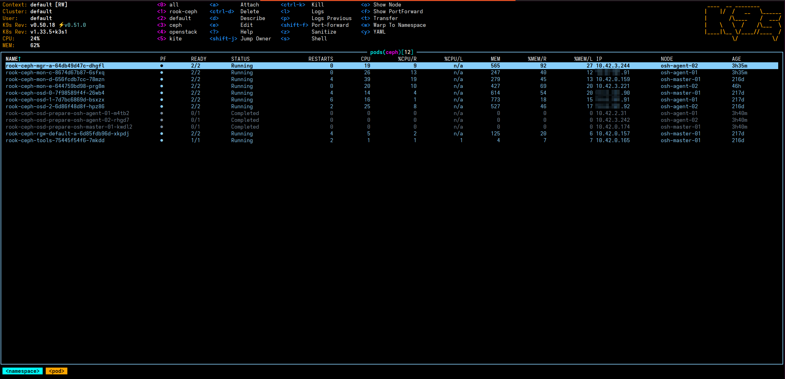

<Aside type="note">
At this stage, we are not yet deploying any OpenStack services. Instead, we are establishing one of the most critical building blocks of the platform: **a shared storage layer that spans all nodes in the cluster**. 

By the time the installation completes, the Kubernetes environment has gained a distributed storage backend capable of supporting Glance image storage, Cinder volumes, and the persistent data requirements of the OpenStack control plane.
</Aside>

The Ceph dashboard is also exposed through the management ingress, allowing you to verify the health of the cluster before proceeding with the OpenStack deployment.

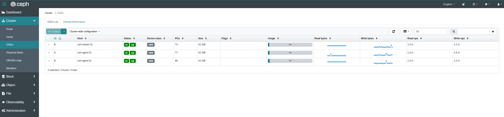

## Install OpenStack-Helm Dependencies

At this point, we have a functioning Kubernetes cluster, a distributed Ceph storage backend, and a network layer capable of exposing services outside the cluster. What we do not have yet is an environment that OpenStack can actually run on.

OpenStack-Helm is a bit more than a collection of Helm charts. It expects Kubernetes to be organized in a particular way, with dedicated ingress paths, storage integrations, scheduling rules, and supporting components already in place. Before we can deploy a single OpenStack service, we need to prepare the cluster for that matter.

The `install-osh-deps.sh` script prepares the environment expected by the OpenStack-Helm charts. This step creates the required namespaces, pulls the OpenStack-Helm repositories, and installs the Rook-Ceph adapter so that OpenStack-Helm can consume the Ceph cluster created in the previous step. It also deploys thededicated NGINX ingress controller for the public OpenStack endpoints. This keeps OpenStack API and dashboard traffic separate from the management services exposed through Traefik . Later, services such as Keystone, Horizon, and Skyline will use this ingress path.

```bash
sudo ./scripts/install-osh-deps.sh
```
<Aside type="note">
K3s ships with [Traefik](https://docs.k3s.io/networking/networking-services#traefik-ingress-controller) as its default ingress controller. Earlier in the deployment, we reconfigured Traefik to listen on ports `8080` *and* `8443`, reserving the standard `80` *and* `443` ports for the dedicated NGINX ingress controller that will expose the OpenStack APIs and dashboards.
</Aside>

Another important part of this step is node preparation. OpenStack-Helm relies on specific node labels and scheduling expectations, so the script adjusts labels and taints to make the K3s nodes suitable for OpenStack workloads. Without this alignment, charts may install successfully but fail to schedule the required pods.

Additionally it will deploy [Kite](https://github.com/kite-org/kite), a modern lightweight Kubernetes web dashboard, and expose it via Traefik.

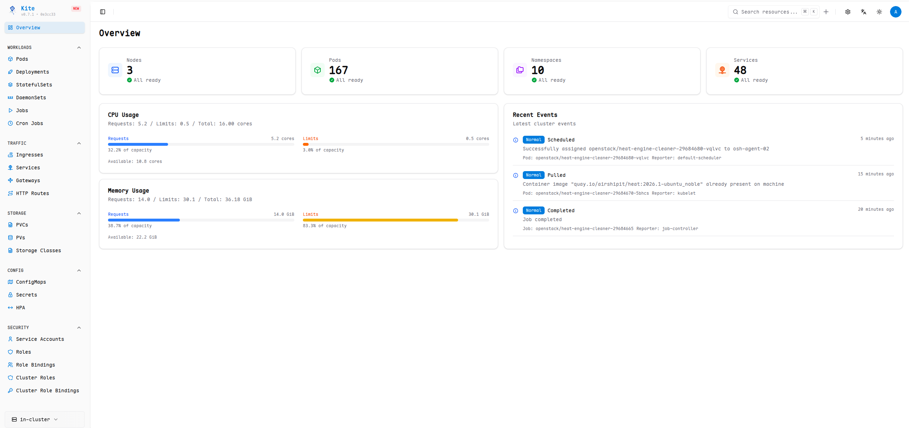

## Install OpenStack Infrastructure Components

Now that Kubernetes has been prepared for OpenStack-Helm, we can start deploying the first OpenStack layer. This is not yet the cloud that users will interact with. There is no dashboard, no identity service, no images, and no virtual machines. What we are deploying here is the internal machinery that the rest of OpenStack depends on.

The infrastructure phase brings up the shared services used by the OpenStack control plane. [MariaDB](https://mariadb.org/) provides the database backend, [RabbitMQ](https://www.rabbitmq.com/) handles service-to-service messaging, [Memcached](https://www.memcached.org/) supports caching, and [Open vSwitch](https://www.openvswitch.org/) lays the groundwork for the networking stack that Neutron will use later.

```bash
sudo ./scripts/install-osh.sh --infra
```

In the next phase we will focus on the actual control plane: identity, image management, dashboards, and the services users will recognize as OpenStack.

## Install OpenStack Core Components

With the underlying infrastructure now in place, we can begin deploying the OpenStack control plane.

1️⃣ This phase introduces the first services that users will directly interact with and marks the transition from platform preparation to cloud deployment. While the previous steps focused on Kubernetes, storage, networking, and supporting infrastructure, this stage establishes the foundations of an operational OpenStack environment.

```bash
sudo ./scripts/install-osh.sh --core
```

The deployment begins with **Keystone**, which serves as the identity service for the entire platform. Every authentication request, service registration, and API interaction ultimately passes through Keystone, making it the central point of trust within the cloud.

Next comes **Glance**, the image service responsible for storing and distributing virtual machine images. Whether launching a Linux distribution, a network appliance, or a custom workload, Glance becomes the catalog from which compute instances obtain their boot images.

To provide a user-facing experience, **Horizon** is deployed as the traditional OpenStack dashboard. Alongside it, we can optionally deploy **Skyline** which offers a more modern web interface built around OpenStack APIs, giving users an alternative way to interact with cloud resources. Both dashboards are exposed through the dedicated NGINX ingress layer established earlier, making them accessible through the public OpenStack endpoints.


 Horizon is the traditional OpenStack dashboard and provides a web-based interface for managing cloud resources, including instances, networks, images, volumes, and projects.

<Aside type="note">
At this stage, our cloud is **not yet** capable of launching virtual machines. The compute and networking services that make this possible are introduced later. What we laid here is the operational foundations of OpenStack: identity management, image management, and user access.
</Aside>

The remaining phases will build upon this foundation by adding storage, orchestration, networking, and ultimately the ability to provision and operate virtual machines.

2️⃣ Although the Kubernetes platform already has access to distributed storage through Ceph, OpenStack still needs a way to expose that storage to its users. This is the role of Cinder.

**Cinder** introduces block storage as a first-class OpenStack service, allowing users and applications to provision persistent volumes independently of the virtual machines that consume them. These volumes can be attached, detached, resized, and managed throughout their lifecycle without affecting the underlying instances.

```bash
sudo ./scripts/install-osh.sh --cinder
```
<Aside type="note">
In this deployment, Cinder is backed by the Ceph cluster that was created earlier. This means that block volumes are not tied to a particular Kubernetes node or compute host. Instead, they are stored on the distributed Ceph backend, providing the resilience and flexibility expected from a real cloud storage service.

While users may not immediately interact with Cinder when exploring the dashboards, many workloads depend on it. Databases, stateful applications, and long-lived virtual machines often require storage that persists beyond the lifetime of a single instance. Cinder provides that capability and completes another essential building block of the cloud platform.
</Aside>

3️⃣ The final component introduced during this phase is Heat, OpenStack’s native orchestration service.

**Heat** allows collections of OpenStack resources to be defined as templates and deployed as a single stack. Rather than creating networks, security groups, volumes, floating IPs, and compute instances individually, Heat coordinates the creation of these resources by interacting with the corresponding OpenStack APIs in the correct order.

```bash
sudo ./scripts/install-osh.sh --heat
```

A Heat template can describe both the resources themselves and the relationships between them. For example, a template can specify that a volume must be attached to a server, or that a floating IP must be associated with a particular instance. Heat then orchestrates the deployment and lifecycle of the entire stack as a single unit.

Although Heat is not required to operate the cloud, it is an integral part of the OpenStack ecosystem and provides the orchestration capabilities expected from a complete OpenStack deployment. By installing it at this stage, we ensure that the environment includes OpenStack’s native mechanism for template-driven resource provisioning and lifecycle management.

4️⃣ The final service deployed, which is optional as we already have installed Horizon, is Skyline, OpenStack’s next-generation web dashboard.

For many years, Horizon has been the primary graphical interface for OpenStack. **Skyline** was introduced to provide a more modern user experience, built around OpenStack APIs and contemporary web technologies while exposing many of the same cloud management capabilities.

```bash
sudo ./scripts/install-osh.sh --skyline
```
<Aside type="note">
Skyline does not replace any core OpenStack functionality. Instead, it provides an alternative way for administrators and users to interact with the platform, complementing the traditional Horizon dashboard already deployed in the previous step.
</Aside>


 Skyline provides a modern web interface for interacting with OpenStack services and complements the traditional Horizon dashboard deployed earlier in the guide.

By exposing both Horizon and Skyline, the environment offers access to both the established OpenStack interface and its newer counterpart, allowing users to choose the experience that best fits their operational preferences.

## Install Libvirt

Up to this point, every component we have deployed has been focused on supporting the OpenStack control plane. This step shifts our attention to the compute layer.

OpenStack ultimately exists to provision and manage virtual machines, and those virtual machines need a hypervisor. In this deployment, that role is provided by [KVM](https://linux-kvm.org/page/Main_Page) and [libvirt](https://libvirt.org/) running directly on the Kubernetes nodes.

The purpose of this step is to prepare the cluster for virtualization workloads **before** the Nova compute services are introduced. Because the deployment runs on Kubernetes, libvirt is not installed in the traditional manner on dedicated hosts. Instead, it is deployed as a Kubernetes workload with the permissions and host access required to interact with the underlying KVM capabilities exposed by each node.

```bash
sudo ./scripts/install-osh.sh --libvirt
```
<Aside type="note">
 It is important to note at this point, that t**he libvirt pods do not immediately transition to a** `Running` **state**. *This is expected*. At this stage, part of the networking infrastructure required by the compute stack is not yet available. Once Neutron and the remaining compute services are deployed in the next phase, libvirt completes its initialization and becomes fully operational.
</Aside>

By the end of this step, the cluster has everything required to host virtual machines from a hypervisor perspective. The final piece missing is the OpenStack compute stack itself, which will connect Nova, Neutron, Placement, and libvirt into a complete virtualization platform.

## Install OpenStack Compute Kit

This is the final major step of the deployment and the point at which our OpenStack cloud becomes fully operational.

Up to now, we have assembled all the supporting layers required by the platform: Kubernetes provides orchestration, Ceph provides storage, the control plane services handle identity and image management, and libvirt has prepared the nodes for virtualization. What remains is to connect these pieces together and introduce the services responsible for scheduling, networking, and running virtual machines.

The compute kit deploys three key OpenStack services: Placement, Nova, and Neutron.

```bash
sudo ./scripts/install-osh.sh --compute
```

**Placement** is responsible for resource inventory and allocation. It maintains an accurate view of the compute resources available across the environment and allows OpenStack services to determine where workloads can be scheduled.

**Nova** provides the compute service itself. It is responsible for managing the lifecycle of virtual machine instances, coordinating with the hypervisor layer, consuming images from Glance, and interacting with the rest of the OpenStack control plane whenever an instance is created, modified, or removed.

**Neutron** delivers networking services to the cloud. It provides the abstractions used to create tenant networks, routers, ports, security groups, and floating IPs, while integrating with the Open vSwitch infrastructure deployed earlier in the process.

This step configures Nova and Neutron to operate with KVM virtualization, Open vSwitch networking, and the Ceph storage backend established in the previous steps. Together, these services transform the environment from a collection of infrastructure components into a functioning Infrastructure-as-a-Service platform. Once this phase completes, our cloud is capable of launching virtual machines. Users can authenticate through Keystone, select images stored in Glance, provision storage through Cinder, consume networking services through Neutron, and have Nova schedule and run workloads across the cluster.

At this point, our OpenStack deployment is complete and ready to host its first instances.

## Validation and Testing

1️⃣ Open your Horizon dashboard at `https://horizon.osh.proxmox.home` (or the equivalent FQDN in your environment) and sign in using the default administrative credentials:

- **Username:** `admin`
- **Password:** `password`
- **Domain:** `Default`

2️⃣ Open **Project** **→ API Access** where you should be able to see all OpenStack services API endpoints we deployed so far:

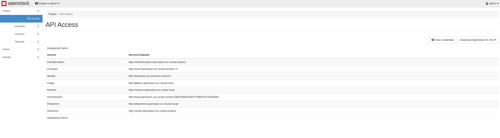

3️⃣ Open **Admin** **→ Compute → Hypervisors → Compute Host** where you should be able to see all KVM hosts available. Make sure their **Status** is `Enabled` and their **State** is `Up`:

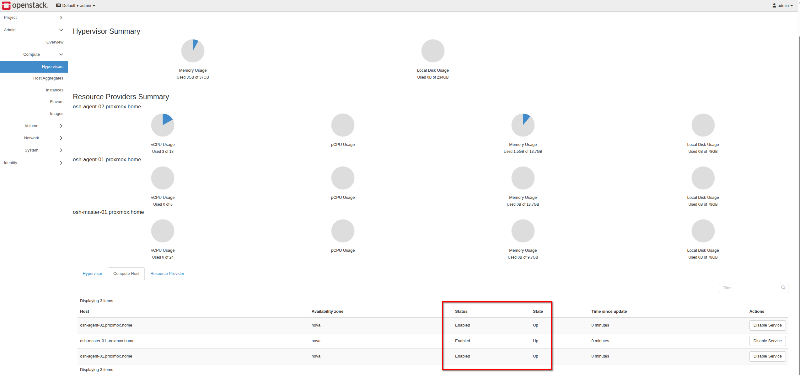

4️⃣ First, we are going to create a shared VPC. Open **Admin** **→ Network → Networks** and click **Create Network.** Choose the following parameter values**:**

- **Name:** `test_vpc`
- **Project:** `admin`
- **Provider Network Type:** `VXLAN`
- **Segmentation ID**: `959`
- **Enable Admin State**: `true`
- **Shared**: `true`
- **MTU**: `1450`
- **Subnet Name**: `test_subnet`
- **Network Address**: `192.168.111.0/24`

The values used for **Segmentation ID** (`959`) and **Network Address** (`192.168.111.0/24`) are provided as examples only. The VXLAN segmentation ID can be any unused identifier within your environment, and the subnet CIDR can be replaced with any non-overlapping private network range that fits your addressing scheme.

These are going to be the private addresses assigned to the virtual machines, valid only within the VPC itself. The only requirement is that both values are unique and do not conflict with existing OpenStack networks.

5️⃣ Next, we are going to create an External Network. Open **Admin** **→ Network → Networks** and click **Create Network.** Choose the following parameter values**:**

- **Name:** `ext`
- **Project:** `admin`
- **Provider Network Type:** `flat`
- **Physical Network**: `public`
- **Enable Admin State**: `true`
- **Shared**: `true`
- **External Network**: `true`
- **Subnet Name**: `ext_subnet`
- **Network Address**: `10.70.0.0/16`
- **Gateway IP**: `10.70.168.1`
- **Enable DHCP**: `false`
- **Allocation Pools**: `10.70.250.1,10.70.250.254`
- **DNS Name Servers**: `10.70.168.1`

Unlike the tenant network created in the previous step, **these values are not arbitrary** and must reflect the characteristics of your environment. The **Physical Network** value (`public`) refers to the Neutron provider network configured by the deployment and mapped to the secondary network interface (`eth1`) of the Kubernetes nodes. The subnet configuration (`10.70.0.0/16`), gateway (`10.70.168.1`), allocation pool, and DNS server originate from the VLAN-backed network attached to that interface and managed by OPNsense. This network serves as the external connectivity layer for OpenStack and is used by services such as floating IPs and provider networks. If your environment uses a different VLAN, subnet, gateway, or address allocation scheme, adjust these values accordingly to match your own network configuration.


 The subnet allocated to VLAN 70, the DHCP address pool used for dynamic address assignment, and the DNS server advertised to clients. These values form the basis of the external network configuration created in Neutron.

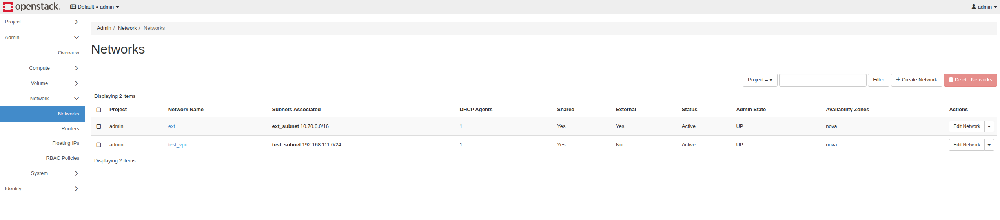

6️⃣ Next, we are going to create a Router and Floating IPs.

Go to **Admin** **→ Network → Routers** and click **Create Router** using as **Name:** `router1`and **External Network:** `ext`. Then, open **router1** and go to **Interfaces → Add Interface** and select as private subnet `test_vpc/192.168.111.0/24`.

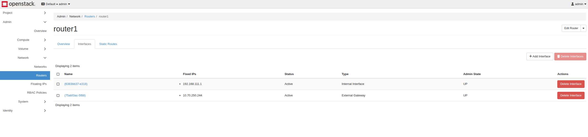

Go to **Admin** **→ Network → Floating IPs** click **Allocate IP to Project**, choose **Pool**: `ext 10.70.0.0/16` and click **Allocate Floating IP** to exit.

7️⃣ With the networking stack in place, it is time to validate that the cloud can perform its primary function: launching virtual machines and providing network connectivity between them.

Create 3 instances using the CirrOS image and the `m1.tiny` flavor. Attach all three instances to the `test_vpc` network created earlier. For one of the instances, also associate the floating IP allocated from the `ext` external network.

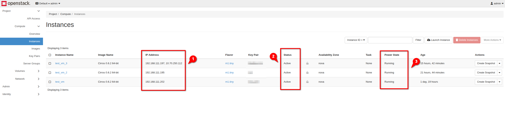

 Our 3 CirrOS instances. Two instances use only tenant networking, while the third is associated with a floating IP from the external network, providing a path for validating external connectivity and SSH access.

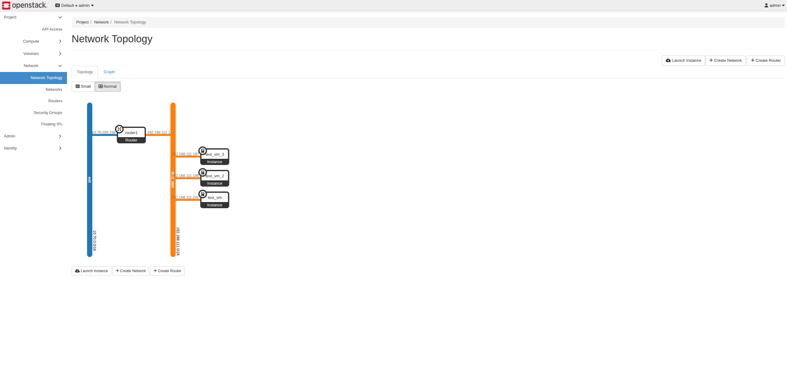

 Our network topology after the deployment of the tenant network, router, floating IP, and test instances.

Once the instances have reached the **Active** state, open their VNC consoles from Horizon and perform a series of connectivity checks:

↔️ Start by verifying **east-west connectivity within the tenant network**. From each instance, ping the private IP addresses of the other two instances to confirm that Neutron networking, Open vSwitch, and the VXLAN overlay are operating correctly.

↕️ Next, **verify north-south connectivity by testing outbound access from the instances to an external destination**. A successful response confirms that routing and external network access are functioning as expected.


 Connectivity validation from a virtual machine running inside the `test_vpc` tenant network. The instance successfully communicates with another instance on the same VXLAN-backed network and reaches an external destination through the Neutron router and external provider network, confirming that both east-west and north-south networking are functioning correctly.

As we can see in the image above:

- **East-west connectivity test**: The instance (`192.168.111.195`) successfully pings another virtual machine (`192.168.111.202`) on the same tenant network, validating Neutron networking, Open vSwitch forwarding, and VXLAN encapsulation between instances.
- **North-south connectivity test:**The instance successfully reaches an external destination (`8.8.8.8`), confirming that routing, source NAT, and connectivity through the external provider network are operating as expected.

🏁 As last step we need to validate floating IP connectivity. From your workstation, establish an SSH connection to the instance that was assigned the floating IP. If the connection succeeds, traffic is successfully traversing the complete network path: OPNsense, the provider network, Neutron, Open vSwitch, and the target virtual machine.

## Closing Thoughts

Running OpenStack on Kubernetes is no longer an experiment or a proof of concept. Projects such as OpenStack-Helm, Rook and Kubernetes have matured to the point where complex cloud platforms can be deployed, operated, and upgraded using the same cloud-native practices that have become commonplace the last years.

At a time when digital sovereignty, technological self-determination, and control over critical infrastructure are rapidly becoming matters of national security, understanding how cloud platforms are built is valuable in its own right. The ability to operate and evolve strategic infrastructure without dependency on foreign providers, proprietary ecosystems, or external political decisions is no longer merely a technical consideration; it is increasingly becoming a question of resilience, autonomy and long-term competitiveness.

{/* Originally published on [Medium](https://akyriako.medium.com/deploy-openstack-on-kubernetes-in-under-60-minutes-f4ff01e2b424). */}