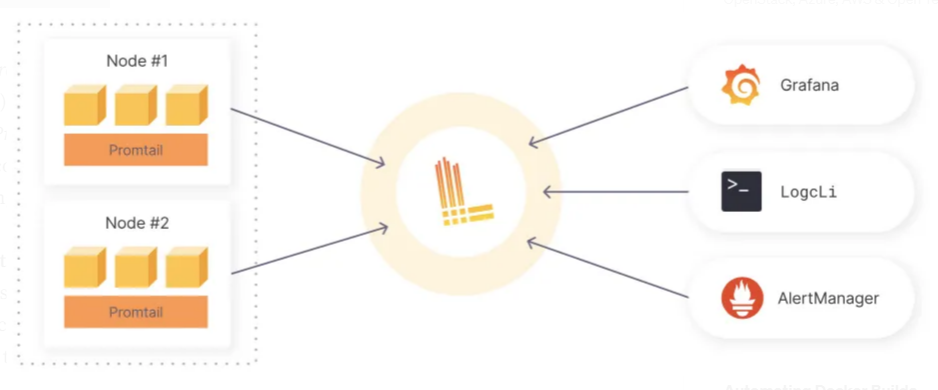
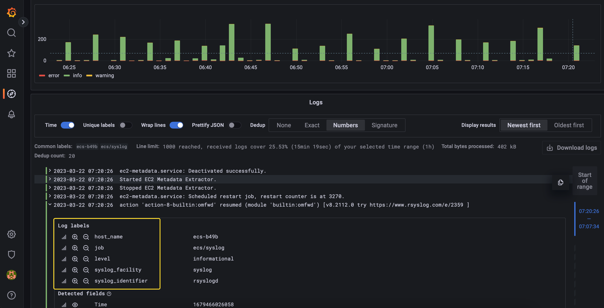
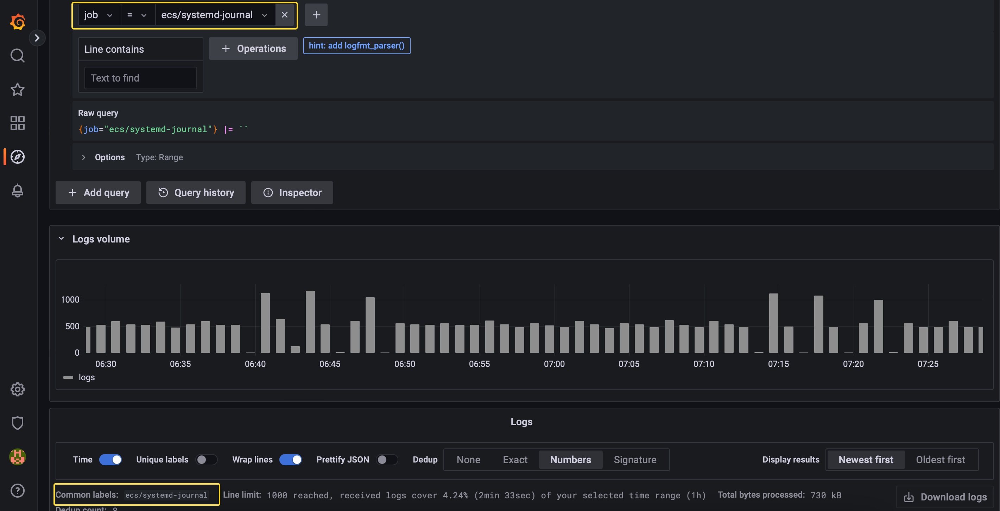
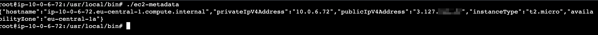
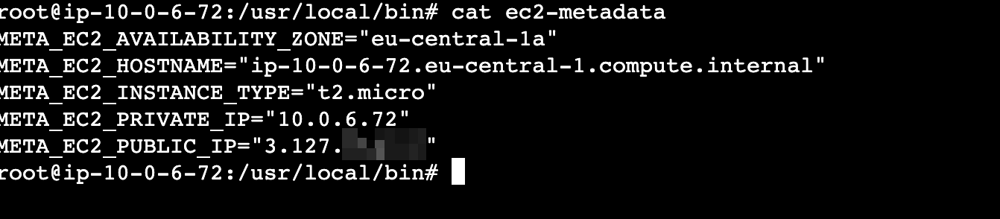
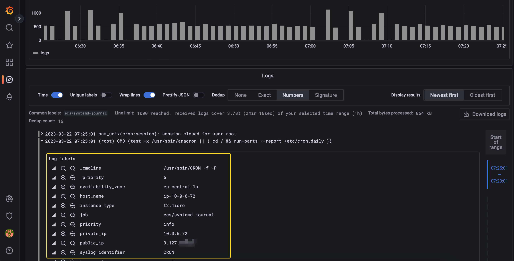

import { Aside } from 'astro-pure/user'
import { GithubCard } from 'astro-pure/advanced'
// import { LinkPreview } from 'astro-pure/advanced'

Consolidating Kubernetes logs into a single, intuitive [**Grafana**](https://grafana.com/) dashboard is relatively straightforward with [**Grafana Loki**](https://grafana.com/oss/loki/) and [**Promtail**](https://grafana.com/docs/loki/latest/clients/promtail/). But Kubernetes is rarely the whole story. Most environments also have virtual machines running various workloads, generating their own mountains of logs. Sooner or later, the need for a unified logging solution becomes unavoidable.

Of course, there are plenty of ways to tackle this. The classic combination of [**Logstash**](https://www.elastic.co/logstash/) or [**Fluentd**](https://www.fluentd.org/) with [**Elasticsearch**](https://www.elastic.co/elasticsearch/) and [**Kibana**](https://www.elastic.co/kibana/) is a perfectly solid approach, and I've got nothing against it. But if we're already using Grafana, Loki, and Promtail for Kubernetes logging, why introduce an entirely different stack just to collect logs from a few virtual machines?

That sounds like unnecessary complexity, and Kubernetes already provides more than enough of that.

Instead, we'll extend the same logging stack to our non-containerised workloads, keeping everything in one place without introducing another collection of services to deploy, configure, and inevitably troubleshoot.
We are going to need additionally some linux servers (personal preference would be [Ubuntu](https://ubuntu.com/download/server)) hosted on [AWS](https://aws.amazon.com/?nc1=h_ls) or on any OpenStack-based cloud (like for instace [Open Telekom Cloud](https://open-telekom-cloud.com/)) or even on an on-premises [OpenStack](https://www.openstack.org/) installation.

<Aside type="note">
Make sure you provision your linux servers in the same **private** subnet that the Kubernetes worker nodes are residing. We are going to need to access the Grafana Loki Gateway service later.
</Aside>

As we’ve explained in the past, [Grafana Loki](https://grafana.com/oss/loki/) is a **logs aggregation system**, more specifically as stated in their website: 

> *...is a horizontally scalable, highly available, multi-tenant log aggregation system inspired by Prometheus. It is designed to be very cost effective and easy to operate. It does not index the contents of the logs, but rather a set of labels for each log stream*.” It’s a fairly new open source project that aws started in 2018 at Grafana Labs.



Loki uses *Promtail* to aggregate logs. [Promtail](https://grafana.com/docs/loki/latest/clients/promtail/) is a **logs collector agent** that collects, (re)labels and ships logs to Loki. It is built specifically for Loki — *an instance of Promtail will run on each Kubernetes node*. It uses the exact same service discovery as Prometheus and support similar methods for labeling, transforming, and filtering logs before their ingestion to Loki.

That means that we have to install the Promtail agent in every virtual machine we created in AWS or in OpenStack.

## Install Promtail

First thing, check the current release of Promtail [here](https://github.com/grafana/loki/releases/) and adjust the script below to target to the actual latest version. We are going to install it in every machine directly from the binaries:

<GithubCard repo='grafana/loki' />


```bash
sudo mkdir -p /opt/promtail
```

We are going to definitely configure our Promtail agent to run as a service, so let’s go and create a designated user for that purpose, and add it to the `adm` group so it can access without problems various log files:

```bash
sudo useradd --system promtail
sudo usermod -a -G adm promtail
```

Adjust the ownership of `/opt/promtail`:

```bash
sudo chown -R promtail:promtail /opt/promtail 
```

and make a sanity check of Promtail itself and of the created user:

```bash
promtail --version
id promtail
```

<Aside type="note">
We’ll put a pin here and configure Promtail itself and then we will come back to configure Promtail’s daemon.
</Aside>

## Configure Promtail

Let’s create a simple Promtail configuration file and fill it in:

```bash
sudo nano /opt/promtail/config-promtail.yaml
```

You need to adjust the following content and assign as `clients::url` the exposed endpoint of your *Grafana Loki Gateway* servicein Kubernetes,`GRAFANA_LOKI_GATEWAY_ENDPOINT`.

If you're running an on-premises Kubernetes cluster, you can expose the service using a `LoadBalancer`. If you don't already have one configured, follow the guide below to deploy and configure MetalLB with minimal fuss:
[Provision a Network Load Balancer on Kubernetes with MetalLB](/blog/provision-a-network-load-balancer-on-kubernetes-with-metallb)

Alternatively, if you are working on a public cloud make sure you create an ***internal*** `LoadBalancer` that lives in the same private subnet with the rest of the machines and then expose this service via this `LoadBalancer`. Be sure to choose an ***internal*** one, otherwise you will send all this big amount of traffic over the public internet which wouldn’t be encouraged for **security** and **cost efficiency** reasons.

Of course it would be more efficient and robust to expose those services via an `Ingress` but this is not in the scope of this post.

What do we eventually want to configure here, are two things: A job that takes care of **syslog** messages and a second job relared to the **journald** messages.

<Aside type="note">
You will definitely ask why both. **Valid question;** first and foremost for the sake of demonstrating the various scraping configuration capabilities of Promtail and secondly because the dust of the internal war between **syslog** & **journald** hasn’t yet settled down.

**syslog** origins go back to the 80’s, when it became the de-facto standard for log management, and until today a lot of distros are still using it as their default solution. Its Linux development stopped somewhen in 2007 but a bunch of forks like **rsyslog**, **syslog-ng** and **nxlog** are carrying on the legacy.

**journald** was introduced in 2011 and created quite heated discussions and controversies with syslog traditionalists. It is essentially the part of systemd that deals with logging, supporting a broad range of features like indexing, structured logging, access control, automatic log rotation. Contrary to the text format of syslog, journald holds the information in binary format. Most of the distributions nowadays include journald as well and it coexists with syslog without any problem. You can find a very interesting paper from Rainer Gerhards and Andre Lorbach as follow-up to the talk of former in LinuxTag 2013 in Berlin, “[rsyslog vs journal](https://rainer.gerhards.net/2013/05/rsyslog-vs-systemd-journal.html)”.
</Aside>

```yaml
server:
  http_listen_port: 3100
```

Promtail discovers locations of log files and extract labels from them through the `scrape_configs` section in the configuration file. The syntax of it, is identical to what [Prometheus](https://prometheus.io/docs/prometheus/latest/configuration/configuration/#scrape_config) uses for the same purpose. Promtail can receive [IETF Syslog (RFC5424)](https://tools.ietf.org/html/rfc5424) messages from either a TCP or UDP stream. Receiving syslog messages is defined by the`syslog` *stanza.* The`listen_address` field is required, and demands a **valid** network address. TCP is the default protocol for receiving messages. Let’s configure now this stream’s endpoint for rsyslog:

```bash
sudo nano /etc/rsyslog.d/99-promtail-relay.conf
```

```bash
# https://www.rsyslog.com/doc/v8-stable/concepts/multi_ruleset.html#split-local-and-remote-logging
ruleset(name="remote"){}

# https://www.rsyslog.com/doc/v8-stable/configuration/modules/imudp.html
module(load="imudp")
input(type="imudp" port="50514")

# https://www.rsyslog.com/doc/v8-stable/configuration/modules/imtcp.html
module(load="imtcp")
input(type="imtcp" port="50514")

# forward everything
*.* action(type="omfwd" protocol="tcp" target="127.0.0.1" port="40514" Template="RSYSLOG_SyslogProtocol23Format" TCP_Framing="octet-counted" KeepAlive="on" action.resumeRetryCount="-1" queue.type="linkedlist" queue.size="50000")
```

Reload the configuration and restart the `rsyslog` daemon:

```bash
sudo systemctl daemon-reload
sudo systemctl restart rsyslog
```

When Promtail receives syslog messages, it brings along all available header fields, that were parsed from the received message, prefixed with `__syslog_` as **internal** label. In the configuration above, `__syslog_message_hostname` field from the will transformed(relabelled) into a target label called `host` through `relabel_configs` — and serve as an index later in Loki and Grafana.

Let’s test it:

```bash
sudo /opt/promtail/promtail-linux-amd64 --config.file=/opt/promtail/promtail-config.yaml --dry-run
```



Now let’s add a second job in `scrape_configs`, one that will point to journald. For that purpose, append the following snippet in the `/opt/promtail/config-promtail.yaml`:

```yaml
- job_name: ecs/journal
    journal:
      json: false
      max_age: 12h
      path: /var/log/journal
      labels:
        job: ecs/systemd-journal
    relabel_configs:
      - action: drop
        source_labels: ["__journal__transport"]
        regex: "kernel"
      - source_labels: ["__journal__systemd_unit"]
        target_label: "unit"
      - source_labels: ["__journal__hostname"]
        target_label: "host_name"
      - source_labels: ["__journal__transport"]
        target_label: "transport"
      - source_labels: ["__journal__cmdline"]
        target_label: "_cmdline"
      - source_labels: ["__journal_priority"]
        target_label: "_priority"
      - source_labels: ["__journal_priority_keyword"]
        target_label: "priority"
      - source_labels: ["__journal_syslog_identifier"]
        target_label: "syslog_identifier"
      - source_labels: ["__journal_syslog_message_severity"]
        target_label: "level"
      - source_labels: ["__journal_syslog_message_facility"]
        target_label: "syslog_facility"
```

It is almost identical, however in this case we have a `journal` stanza and a `path` parameter that points to the location of the journal file in the filesystem,`/var/log/journal`, instead of a `listening_address` and a `syslog` stanza. The incoming available header fields of [journal](https://manpages.debian.org/testing/systemd/systemd.journal-fields.7.en.html), in this case prefixed with `__journal_`, will be relabelled accordingly so they don’t create overlapping indices later in Grafana Loki.

Let’s try it again, and go have a look in our Grafana Dashboard:

```bash
sudo /opt/promtail/promtail-linux-amd64 --config.file=/opt/promtail/promtail-config.yaml --dry-run
```



## Configure Promtail with environment variables

So far so good, we can collect in almost real-time the log files from various servers and explore them via Grafana. Nevertheless, there’re bits of information that are missing and they would be invaluable for future incidents investigations or audits. For example, although we do know the host name of our machines, we have no information about its *IP addresses* or the *availability zone* that they’ve been provisioned.

Both [AWS](https://docs.aws.amazon.com/AWSEC2/latest/UserGuide/instancedata-data-retrieval.html) and [OpenStack](https://docs.openstack.org/nova/latest/user/metadata.html) provide a metadata service for their virtual machine instances in order to retrieve instance-specific data.

```
http://169.254.169.254/latest/meta-data/
```

OpenStack specifically provides two versions of this API, an OpenStack metadata API and an EC2-compatible API. Both APIs *are versioned by date*. The later uses the same endpoint as AWS and the former listen to the address:

```
http://169.254.169.254/openstack/latest/meta-data/
```

In this article, we will use the *EC2-compatible* endpoint in order to cover simultaneously the AWS and OpenStack instance metadata retrieval cases.

In order to retrieve those instance metadata, I wrote a small program in Go that simply calls those endpoints and retrieves the following information: *hostname*, *private* *IPV4* address, *public* *IPV4* address (if any), *instance/flavour type* and *availability zone*. The source code and the release binaries can be found in [this](https://github.com/akyriako/ec2-metadata) repository. Download and install it in your linux servers. (there is a deb as well but still not fully tested — so I recommend you just install it directly from the *tar.gz* to `/usr/local/bin`)

<GithubCard repo='akyriako/ec2-metadata' />


You can either execute without parameters and it will produce a JSON output:

```bash
 sudo ./usr/local/bin/ec2-metadata
```



or you can export those metadata in a file as env variables

```bash
sudo ./usr/local/bin/ec2-metadata > /opt/promtail/instance-metadata
```



We are going to use the second option here, because we want to find a way to feed our Promtail agent and decorate the collected log traces with instance-specific metadata. We can infer to environment variable in the Promtail configuration file in order to set values that need to be configurable during deployment. To do this, we need to pass `-config.expand-env=true` as a startup flag to our Promtail agent and use in the configuration our environment variables as `$VAR`.

```bash
sudo ./opt/promtail/promtail-linux-amd64 --config.file=/opt/promtail/config-promtail -config.expand-env=true
```

That requires changes in our Promtail configuration file.

We need first to add a segment that reads the values of these environment variables as hidden metadata (in the `journal/label` stanza)

```yaml
journal:
  json: false
  max_age: 12h
  path: /var/log/journal
  labels:
    job: ecs/systemd-journal
    __meta_ecs_instance_type: ${META_EC2_INSTANCE_TYPE}
    __meta_ecs_availability_zone: ${META_EC2_AVAILABILITY_ZONE}
    __meta_ecs_public_ip: ${META_EC2_PUBLIC_IP}
    __meta_ecs_private_ip: ${META_EC2_PRIVATE_IP}
```

<Aside type="note">
Pay attention that we created labels with a double trailing underscore (`__meta_ecs_`) in order to ensure that they will be hidden.
</Aside>

and a second addition to the `relabel_configs` stanza where will instruct Promtail to transform those hidden metadata to actual labels that could be consequently become indexable and filterable entities in Loki:

```bash
 - source_labels: ["__meta_ecs_availability_zone"]
   target_label: "availability_zone"
 - source_labels: ["__meta_ecs_instance_type"]
   target_label: "instance_type"
 - source_labels: ["__meta_ecs_public_ip"]
   target_label: "public_ip"
 - source_labels: ["__meta_ecs_private_ip"]
   target_label: "private_ip"        
```

Let’s try it now again:

```bash
sudo ./opt/promtail/promtail-linux-amd64 --config.file=/opt/promtail/config-promtail -config.expand-env=true
```

You should now, if all went right, be able to see the new labels in Grafana dashboard when you choose the `ecs/systemd-journal` job:



Assuming your box is living in a fairly volatile and dynamic environment — and it does, the values of some of those metadata might change over time (e.g. the public IP address). We need to find a way to reload both the metadata values themselves and the configuration file of Promtail that points to those variables. We can achieve that in a two steps trick, by creating two services that run periodically, one for ec2-metadata and one for Promtail.

For *ec2-metadata* let’s create the following Unit file:

```bash
sudo nano /etc/systemd/system/ec2-metadata.service
```

and add the following content to it:

```ini
[Unit]
Description=EC2 Metadata Extractor
After=network.target
AssertPathExists=/usr/local/bin/ec2-metadata

[Service]
Type=notify-reload
User=root
WorkingDirectory=/usr/local/bin
ExecStart=/usr/local/bin/ec2-metadata --path /opt/promtail/ec2-metadata
SuccessExitStatus=143
Restart=always
RestartSec=180
ReloadSignal=1
TimeoutStopSec=10
WatchdogSec=180

[Install]
WantedBy=multi-user.target
```

For Promtail now, we will create another Unit file:

```bash
sudo nano /etc/systemd/system/promtail.service
```

```ini
[Unit]
Description=Promtail
After=network.target

[Service]
Type=notify-reload
User=promtail
Group=adm
WorkingDirectory=/opt/promtail
ExecStart=/opt/promtail/promtail-linux-amd64 --config.file=/opt/promtail/config-promtail.yaml -config.expand-env=true
EnvironmentFile=/opt/promtail/bin/instance-metadata
SuccessExitStatus=143
Restart=always
RestartSec=5
ReloadSignal=1
TimeoutStopSec=10
WatchdogSec=180

[Install]
WantedBy=multi-user.target
```

There are plenty of small details in these Unit file. We want that they runs periodically so we define `Type` as a`notify-reload` one and set the `WatchdogSec` to 180 seconds. That will reboot our service every 3mins.

We instruct Promtail agent in `ExecStart` to use the configuration file we created and use the environment variables in place, that are defined by an additional flag that is called `EnvironmentFile` and points to the `/opt/promtail/instance-metadata` that the ec2-metadata daemon — we created above — will periodically update with the actual instance metadata. Reload the configuration and sit back and watch the services recycling themselves in constant intervals — there is no performance hit to your system.

```bash
sudo systemctl daemon-reload
sudo systemctl enable ec2-metadata.service
sudo systemctl enable promtail.service
sudo systemctl restart ec2-metadata.service
sudo systemctl restart promtail.service
```

<Aside type="caution">
You can exploit **any** kind of data or metadata from your systems or your custom applications and using the very same rationale to inject them as labels and decorate your logs before sending to Loki. Using the EC2-Compatible API endpoint to gather instance specific metadata was just for demonstrating purposes — nevertheless it is very useful
</Aside>

<Aside type="note">
In theory, Promtail in EC2 instances provide out of the box many labels prefixed as `__meta_ec2_` ready to be consumed and scraped, but to be very honest I didn’t manage to get it working out the box and there’re bunch of people raising similar issues and concerns.
</Aside>

## Next steps

That were a lot of manual steps and there is definitely a lot of space for improvement. You can easily pack all those steps in a [cloud-init](https://cloudinit.readthedocs.io/en/latest/) file and let every virtual machine you create from now get configured automatically on their first boot — and receive almost spontaneous all their logs in your dashboard from the very first second they are up and running. That’s fairly easy and we will explore it in a future post.

Additionally a nice Grafana dashboard would add extreme value to the whole solution. You can find plenty of them [here](https://grafana.com/grafana/dashboards/?search=Loki) and tailor the one you like to your needs.

{/* Originally published on [Medium](https://medium.com/@akyriako/linux-logging-with-grafana-loki-custom-promtail-labels-from-openstack-or-aws-ec2-metadata-436625cb644c) */}
