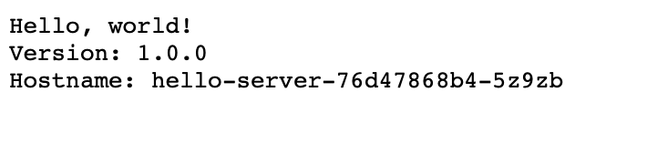
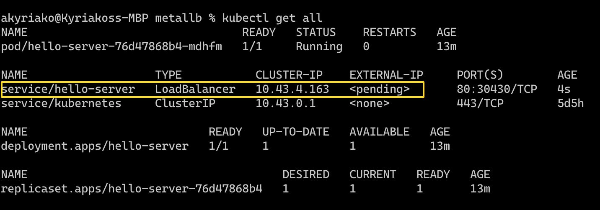
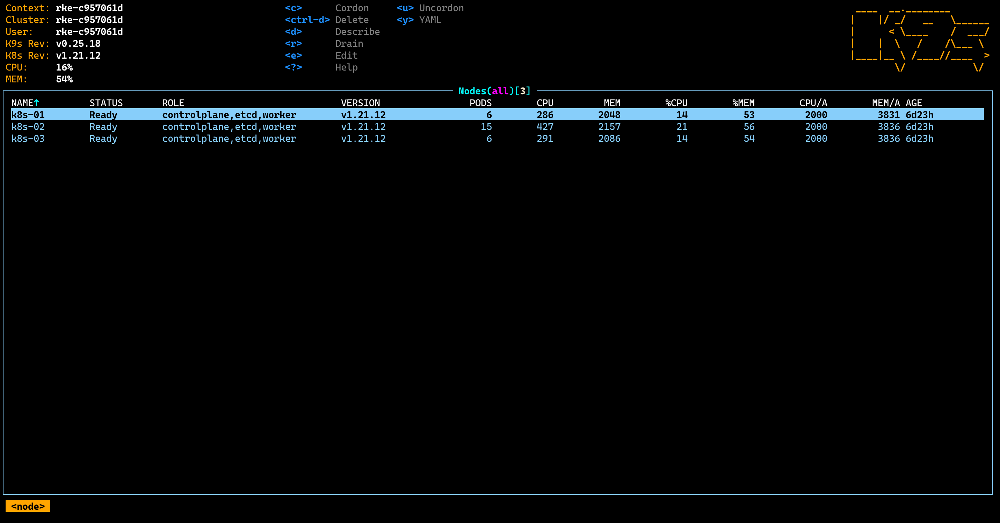
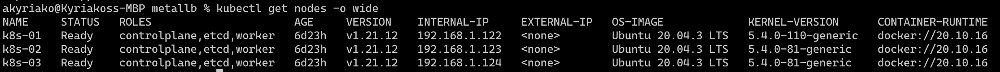
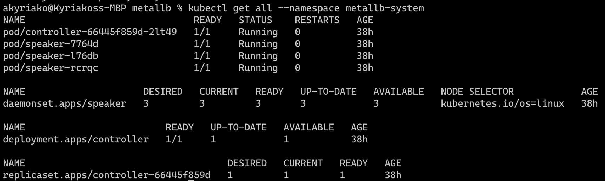
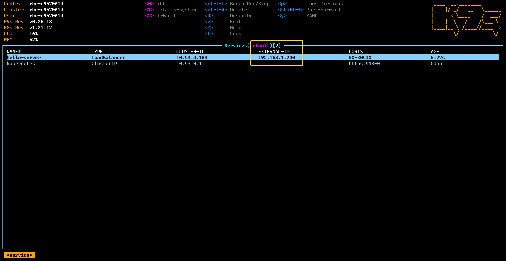
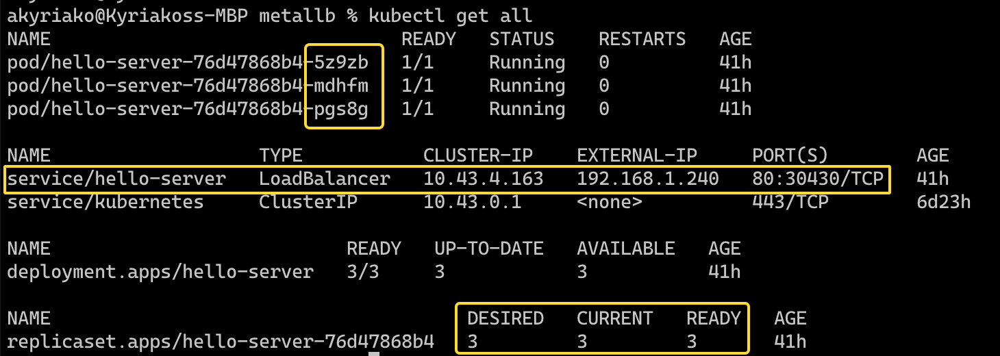
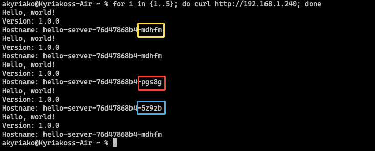

import { Aside } from 'astro-pure/user'


<Aside type="tip" title="TL;DR">
Kubernetes `LoadBalancer` services work beautifully in public clouds, but on bare-metal clusters, their external IPs tend to sit in `Pending` forever. Because apparently providing an IP address requires a cloud provider.

This article shows how to fix that with **MetalLB**, using Layer 2 mode to assign external IPs from your local network. We'll install MetalLB, configure an `IPAddressPool` and `L2Advertisement`, and deploy a sample application to demonstrate load balancing across multiple Pods.

No cloud provider, no expensive load balancer appliances, and no unnecessary complexity. Just Kubernetes services with external IPs that actually work.
</Aside>

## Overview

Kubernetes offers the following service types:

1. ***ClusterIP***: provides a load-balanced IP address for one or more pods that match a label selector and forwards requests to this IP address. Consequently that is a service that is accessible only within your cluster. No external client or application can reach the exposed endpoints. Only exception is via Kubernetes proxy but this is neither a permanent nor a rigid solution that should be used beyond development purposes (that’s a non-option even for dev environments, if you ask my personal opinion)
2. ***NodePort***: this one exposes a static or dynamic port, depends on the configuration, in the range of high ports 30000–32767, on **every** node. It is build on top of a *ClusterIP* type service by exposing the ClusterIP service outside of the cluster by forwarding client traffic, via kube-proxy, to the exposed node ports.
3. ***LoadBalancer***: this service type is built on top of a *NodePort* service type by provisioning and configuring external load balancers and exposing one or more pods that match a label selector and forwards layer 4 traffic to the underlying worker nodes that host and expose those pods. When you create a LoadBalancer service in a Public Cloud (e.g AWS, Azure, GCP, Open Telekom Cloud etc) there is the required glue in place to spin a new Network Load Balancer and assign its IP address as the external IP of the LoadBalancer service. In a private cloud or on-premises **however**, the implementations of network load balancers are missing and this is the void that MetalLB comes to fill in.
4. ***ExternalName***: this service type returns and is been accessed by a CNAME record instead of a clusterIP address. We will dissect this service in another article as it a quite interesting option that deserves a space of its own.

<Aside type="note">
I am not going to refer to Ingresses at all in this article, as they are a different sort of resource and do not technically belong to this `kind` although they facilitate similar functionality, but in another OSI layer.
</Aside>

Without MetalLB or any similar software solution — we are talking only software solutions here — the *External IP* of any new created service in Kubernetes will stay **indefinitely in pending state**. MetalLB’s purpose is to cover this deficit by offering a network load balancer implementation that integrates with standard network equipment, so that external services on bare-metal clusters work in a similar way as their equivalents in IaaS platform providers.

Let’s try it ourselves for a moment. We are going to use a sample image from google, `grc.io/google-samples/hello-app:1.0`, that spins a lightweight web server that comes very handy for this demo as it shows in the landing page the name of the pod.



This is what we expect to see when we open our app in a browser

```bash
kubectl create deployment hello-server --image=gcr.io/google-samples/hello-app:1.0
```

and next we want to expose the service:

```bash
kubectl expose deployment hello-server --type LoadBalancer --port 80 --target-port 8080
```

let’s see now what effect those two commands had:

```bash
kubectl get all
```



As you can notice the External IP for our hello-server service is in pending state, and this is **not** going to change. Remove the deployment and let’s try to solve this little inconvenience.

## Installation

I have an on-prems 3-nodes RKE Cluster already provisioned, let’s have a quick look at it:



or alternatively from the terminal via `kubectl`:

```bash
kubectl get nodes -o wide
```



The installation of MetalLB is easy as a breeze, and we are going to perform it by applying the necessary manifests (everything will be provisioned in a new namespace named `metallb-system`):

```bash
kubectl apply -f https://raw.githubusercontent.com/metallb/metallb/v0.13.7/config/manifests/metallb-native.yaml
```

and then we need to provide the components required by MetalLB. The next manifest will deploy MetalLB to the cluster, in `metallb-system` namespace we just created. The components are:

- the `metallb-system/controller` *deployment*. A cluster-wide controller that handles IP assignments.
- the `metallb-system/speaker` which is a *daemonset*. That is the component to make the services reachable.
- and the *service accounts* for the controller and speaker, along with the *RBAC permissions* that the components require.

Let’s see what is provisioned so far:

```sql
kubectl get all --namespace metallb-system
```



The installation manifest does **not** include a configuration file. MetalLB’s components although will start, they will remain idle until we provide the required configuration as an `IpAddressPool`, a new `Kind` introduced in this version and replaced the old way of provisioning address pool configuration with `ConfigMap`.

Let’s name it `ipaddresspool.yaml`:

```yaml
apiVersion: metallb.io/v1beta1
kind: IPAddressPool
```

We are going to use Layer 2 configuration. Layer 2 mode is the simplest to configure and we are going to need only **a range of IP addresses**. As explained in the official documentation:

*Layer 2 mode does not require the IPs to be bound to the network interfaces of your worker nodes. It works by responding to ARP requests on your local network directly, to give the machine’s MAC address to clients.*

In this example I am going to bind MetalLB with the addresses from`192.168.1.240` to `192.168.1.250`of my home network.

<Aside type="caution">
Make sure you exclude this slice from the address pool of your DHCP server, otherwise you will run into troubles.
</Aside>

For this we need to create an additional manifest and provision an object of type `L2Advertisement` (that’s a newly introduced `kind` as well).

Let’s name it `l2advertisement.yaml`:

```bash
apiVersion: metallb.io/v1beta1
kind: L2Advertisement
metadata:
  name: default
  namespace: metallb-system
spec:
  ipAddressPools:
  - default-pool
```

<Aside type="note">
When MetalLB sets the external IP address of an ingress LoadBalancer service, the corresponding entries are created in the **iptables NAT table** and the node with the selected IP address starts responding to HTTP requests on the ports configured in the LoadBalancer Service.
</Aside>

Now let’s deploy these manifests:

```bash
kubectl apply -f ipaddresspool.yaml
kubectl apply -f l2advertisement.yaml
```

Now we are ready to test a workload once again!

## Take it for a test drive

Let’s try once again to deploy the workload that we failed to properly expose before having MetalLB in place:

```bash
kubectl create deployment hello-server --image=gcr.io/google-samples/hello-app:1.0
```

then, expose the service

```bash
kubectl expose deployment hello-server --type LoadBalancer --port 80 --target-port 8080
```

and let’s see what happened this time: Deployments, Pods, ReplicaSets are identical but the Service itself has a pleasant surprise for us: The first IP from our pool has been assigned as the External-IP of the service!




First let’s **scale our deployment** in order to see the load-balancing effect clearer

```bash
kubectl scale --replicas=3 deployment hello-server
```



Let’s try to call the load-balanced endpoint now:

```bash
for i in {1..5}; do curl http://192.168.1.240; done
```



That was pretty neat, right? Check out how the requests are load-balanced among our 3 pods!

## Conclusion

The whole installation lasts no longer than 5 minutes and solves once and for all an issue that in the first sight is rather obscure and complicated for beginners in Kubernetes. In a soon-to-come article we will see how we can expose our services out of the boundaries of Kubernetes even more efficiently by using an Nginx Controller Ingress. Stay tuned!

{/* Originally published on [Medium](https://medium.com/@akyriako/load-balancing-with-metallb-in-bare-metal-kubernetes-271aab751fb8) */}
