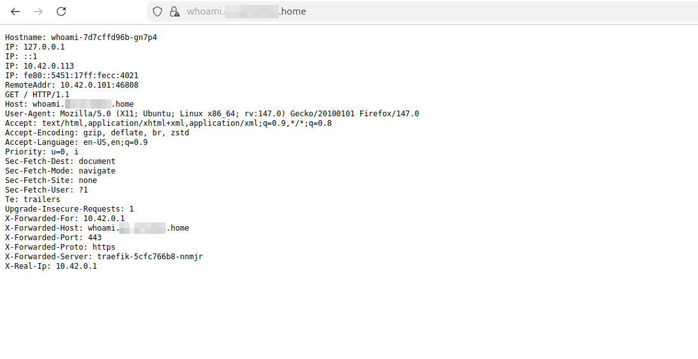

import { Aside } from 'astro-pure/user'

<Aside type="caution">
Ingress NGINX Controller for Kubernetes is retired on March 2026 and Kubernetes Ingress API will receive no future development. Configure Traefik as a shared Gateway in [K3s](https://k3s.io/).
</Aside>

The Kubernetes [**Ingress API**](https://kubernetes.io/docs/concepts/services-networking/ingress-controllers/) is feature-frozen and will not developed any further. New traffic management capabilities are being developed in the Kubernetes [**Gateway API**](https://kubernetes.io/docs/concepts/services-networking/gateway/), which provides a more expressive and extensible model for service networking, but is still lacking the feature parity with the Ingress API. As stated in Kubernetes official documentation:

**“The Kubernetes project recommends using** [**Gateway**](https://gateway-api.sigs.k8s.io/) **instead of** [**Ingress**](https://kubernetes.io/docs/concepts/services-networking/ingress/). The Ingress API has been frozen. This means that:
 - The Ingress API is generally available, and is subject to the [stability guarantees](https://kubernetes.io/docs/reference/using-api/deprecation-policy/#deprecating-parts-of-the-api) for generally available APIs. The Kubernetes project has no plans to remove Ingress from Kubernetes.
 - The Ingress API is no longer being developed, and will have no further changes or updates made to it.”

In the meantime, the [**ingress-nginx**](https://github.com/kubernetes/ingress-nginx/) project (Ingress NGINX Controller for Kubernetes) [retires on March 2026](https://www.kubernetes.dev/blog/2025/11/12/ingress-nginx-retirement/), forcing half of the Kubernetes universe racing against time to migrate to a viable alternative.

Ingress and Gateway APIs **can coexist** in the same cluster. Migration does not need to be immediate or global. Many environments adopt Gateway API incrementally by introducing **shared Gateways** for new workloads while continuing to run existing services behind Ingress.

Using a **shared Gateway** has several advantages. It allows a single, centrally managed entry point to serve multiple applications, reduces duplication of configuration, and limits the permissions required by application teams. Applications only need to create route resources in their own namespaces, while certificates, listeners, and exposure policies remain under the control of the Gateway owner.

## Gateway API Components

The Gateway API defines a set of resources that separate **infrastructure concerns** from **application routing concerns**. Each resource (4 stable at the time of writing) has a clear responsibility and scope:

### GatewayClass

A `GatewayClass` represents a type of Gateway implementation (exactly as the `IngressClass` for the Ingress API). It is defined by the infrastructure or platform layer and is typically installed by a Gateway controller (for example, Traefik, Envoy Gateway, Kong and [many others](https://gateway-api.sigs.k8s.io/implementations/#gateway-controller-implementation-status)).

<Aside type="note">
Application teams do not interact with `GatewayClass` directly.
</Aside>

### Gateway

A `Gateway` represents a network entry point into the cluster. It defines where and how traffic enters the system (per cluster if shared or per application if dedicated).

<Aside type="note">
Gateways are usually managed by platform or infrastructure teams and are often shared across multiple applications and namespaces.
</Aside>

### Routes

Routes define **application-level routing** to backend services and attach to a Gateway. `HTTPRoute` is the most common route type and is used for good ole’ HTTP and HTTPS traffic. `GRPCRoute` on the other hand, defines gRPC-specific rules for routing traffic from a Gateway to backend network endpoints.

<Aside type="note">
Routes are typically created and managed by application teams in their own namespaces.
</Aside>

## Configure K3s Helm Charts Manifests

[K3s](https://k3s.io/), in its default configuration, comes pre-configured with Traefik and this where we are going to focus on. Traefik Gateway CRDs are installed but no `GatewayClass` or `Gateway` are enabled or deployed. K3s is bootstrapped with a Traefik Ingress.

K3s uses a built-in mechanism to deploy and manage core cluster components using Helm charts. This mechanism is implemented through two custom resources: `HelmChart` and `HelmChartConfig`. Together, they allow K3s to install, configure, and upgrade packaged applications during cluster startup and runtime.

This system is primarily used to bootstrap components such as Traefik, CoreDNS, metrics-server, and other optional add-ons. The presence of a `HelmChart` resource signals the K3s Helm controller to install or upgrade the corresponding Helm release and a `HelmChartConfig` resource provides user-defined overrides for a corresponding `HelmChart`. K3s supports placing manifests under:

```
/var/lib/rancher/k3s/server/manifests/
```

This mechanism allows cluster configuration and enables automatic upfront bootstrapping and (re)configuration without the need of manual Helm commands. To configure Traefik, we need to update the `traefik-config.yaml` as following:

- Enable the `kubernetesGateway` under `providers`.
- Add a new stanza `gateway.listeners`. We need to add two listeners, one for HTTP and one HTTPS traffic and point them to the internal ports of the Traefik container, namely `8000` and `8443` respectively.
- Each listener should explicitly set `namespacePolicy.from` to `All`. Without this configuration, the value defaults to `Same`, restricting Gateway access to workloads within the same namespace only.
- For the HTTPS listener set `mode` to `Terminate`. With this knob TLS connections are terminated at the Gateway. TLS handling is centralized at the Gateway and like this we avoid the need for individual applications to manage certificates or serve HTTPS themselves.
- When using `protocol: HTTPS` with `mode: Terminate`, the Gateway **must** reference **at least one TLS certificate**. Without a certificate, the Gateway controller cannot program the listener. Certificates are referenced using the stanza`certificateRefs`, which point to Kubernetes `Secret` objects of type `kubernetes.io/tls`. The `Secret` must exist in the same namespace as the `Gateway`, contain a valid certificate and private key and of course match the hostnames served by the listener.

<Aside type="note">
In a shared Gateway setup, certificate management is typically handled by the platform or infrastructure layer.
</Aside>

```
apiVersion: helm.cattle.io/v1  
kind: HelmChartConfig  
metadata:  
  name: traefik  
  namespace: kube-system  
spec:  
  valuesContent: |-  
    providers:  
      kubernetesIngress:  
        enabled: true  
      kubernetesGateway:  
        enabled: true  
    gateway:  
      listeners:  
        web:  
          port: 8000  
          protocol: HTTP  
          namespacePolicy:  
            from: All  
        websecure:  
          port: 8443  
          protocol: HTTPS  
          mode: Terminate  
          certificateRefs:  
            - kind: Secret  
              name: wildcard-cert-tls  
          namespacePolicy:  
            from: All
```

Create the `wildcard-cert-tls` (see next paragraph) and **then** restart the K3s service to pick up the changes. It should provision a `GatewayClass` and a `Gateway` in namespace *kube-system*.

```
sudo systemctl restart k3s
```
<Aside type="note">
Assuming you are running a Debian-family operating system; otherwise, adjust the command above accordingly.
</Aside>

## Create a Wildcard Certificate

A wildcard certificate allows a single certificate to cover multiple hostnames under the same domain. For example, a certificate for `*.apps.mylab.home` can be used for serving multiple applications e.g.:

- `whoami.apps.mylab.home`
- `grafana.apps.mylab.home`
- any other subdomain under `apps.mylab.home`

This is useful in shared Gateway deployments, where multiple applications attach routes to the same HTTPS listener.

Let's lay the create a wildcard certificate for our private published services

1️⃣ Create a file **wildcard.cnf** and paste the following:

```
[req]  
default_bits       = 4096  
prompt             = no  
default_md         = sha256  
distinguished_name = dn  
x509_extensions    = v3_req  
  
[dn]  
CN = apps.mylab.home  
  
[v3_req]  
subjectAltName = @alt_names  
keyUsage = digitalSignature, keyEncipherment  
extendedKeyUsage = serverAuth  
  
[alt_names]  
DNS.1 = apps.mylab.home  
DNS.2 = *.apps.mylab.home
```
<Aside type="note">
Replace `CN`,`DNS.1` *and* `DNS.2` with the values specific to your environment.
</Aside>

2️⃣ Create the Certificate

```
openssl req -x509 -nodes -days 825 \  
  -newkey rsa:4096 \  
  -keyout tls.key \  
  -out tls.crt \  
  -config wildcard.cnf
```

3️⃣ Create the Kubernetes Secret

```
kubectl -n kube-system create secret tls wildcard-cert-tls \  
  --cert=tls.crt \  
  --key=tls.key
```

4️⃣ Create DNS Records

You have to make sure that the external IPs that are assigned to your Gateway/Ingress (the node IPs in case of a vanilla K3s) are pointing, with or without a floating IP, to `*.apps.mylab.home`. Adjust your DNS records accordingly.

Once both Gateway and Secret are configured, the Gateway can serve HTTPS for any route whose hostname matches the certificate.

<Aside type="note">
If on the other hand you are planning to expose services to the public, TLS certificates should be issued by a publicly trusted certificate authority (like Let’s Encrypt for instance). In Kubernetes environments, this is commonly handled using [**cert-manager**](https://cert-manager.io/) with a DNS-based ACME challenge ([DNS-01](https://cert-manager.io/docs/configuration/acme/dns01/)). DNS validation is required for wildcard certificates and/or for clusters that are not directly reachable over HTTP.

In this setup, cert-manager is responsible for obtaining and renewing the certificate, while the resulting TLS `Secret` is referenced by the Gateway listener. The DNS provider configuration (DNS solver) must be able to create and remove validation records for the target domain.

This approach allows certificate management to remain automated and independent of application routing configuration.
</Aside>

## Create a Workload

We are going to test the whole setting now with deploying and exposing [traefik/whoami](https://github.com/traefik/whoami) internally.

1️⃣ Create and deploy the manifests for the application itself

```
apiVersion: v1  
kind: Namespace  
metadata:  
  name: whoami  
---  
apiVersion: apps/v1  
kind: Deployment  
metadata:  
  name: whoami  
  namespace: whoami  
spec:  
  replicas: 3  
  selector:  
    matchLabels:  
      app: whoami  
  template:  
    metadata:  
      labels:  
        app: whoami  
    spec:  
      containers:  
        - name: whoami  
          image: traefik/whoami:v1.11  
          ports:  
            - name: http  
              containerPort: 80  
---  
apiVersion: v1  
kind: Service  
metadata:  
  name: whoami  
  namespace: whoami  
spec:  
  selector:  
    app: whoami  
  ports:  
    - name: http  
      port: 80  
      targetPort: http
```

2️⃣ Create and deploy the manifests for the Route

```
apiVersion: gateway.networking.k8s.io/v1  
kind: HTTPRoute  
metadata:  
  name: whoami  
  namespace: whoami  
spec:  
  parentRefs:  
    - name: traefik-gateway  
      namespace: kube-system  
  hostnames:  
    - whoami.apps.mylab.home  
  rules:  
    - matches:  
        - path:  
            type: PathPrefix  
            value: /  
      backendRefs:  
        - name: whoami  
          port: 80
```



Of course the Certificate is not trusted as it is a self-signed one.

## Closing Thoughts

Retiring [**kubernetes/ingress-nginx**](https://github.com/kubernetes/ingress-nginx) sets a genuinely bad precedent for the ecosystem because it shows that even *foundational* “it’s everywhere” components can become unsustainable and then get shut down without a fully community-owned succession plan.

There isn’t a single definitive estimate of the blast radius of this event, but the Kubernetes Steering Committee itself in a statement calls it “*the piece of critical infrastructure for about* ***half*** *of cloud native environments.*”. You get the picture right?

**So act now, before you need to (re)act under pressure after March 2026**.

As long as Ingress API is getting no new features, sooner or later you’ll need considering moving to Gateway API (unless you have a strong technical reason to do otherewise).

<Aside type="caution">
This article does not advocate replacing the Kubernetes Ingress NGINX Controller with Traefik Gateway. It simply explains how to configure a K3s cluster to use a shared Gateway, leaving the choice of controller to your specific needs.
</Aside>

Originally published on [Medium](https://medium.com/itnext/configure-a-shared-tr%C3%A6fik-gateway-on-k3s-b09fb0d32c6e)