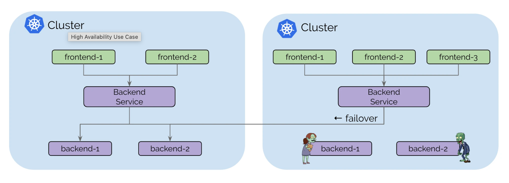
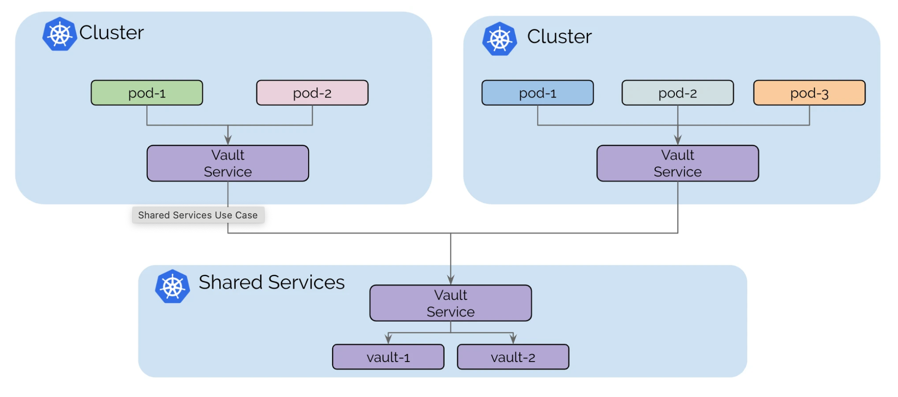
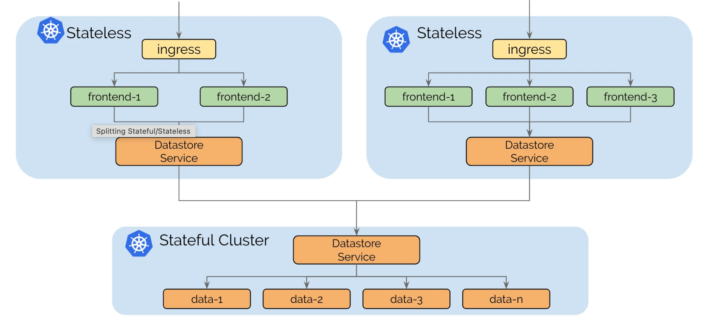
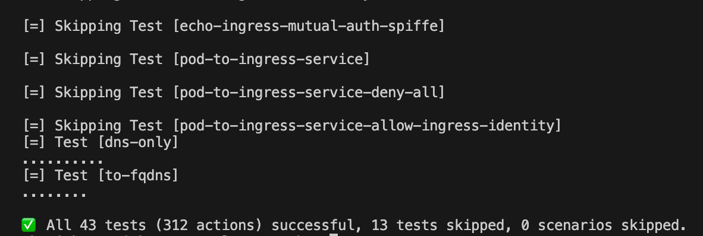

import { Aside } from 'astro-pure/user'
import { GithubCard } from 'astro-pure/advanced'

<Aside type="tip" title="TL;DR">
Build a multi-cluster Kubernetes environment on your local machine using **KIND, Cilium ClusterMesh, and MetalLB**. We'll spin up two independent Kubernetes clusters, replace the default networking with Cilium, configure load balancing, and connect everything into a single mesh.

By the end, you'll have cross-cluster Pod connectivity, service discovery, and network policy enforcement, all running locally in Docker containers. We'll also validate the setup using Cilium's multi-cluster connectivity tests.

Two Kubernetes clusters, one laptop, and a networking setup that would normally require considerably more infrastructure.
</Aside>

## What do we need?

<Aside type="note">
It is **strongly** advised to run this lab on a Linux machine, my choice was Ubuntu, as Docker Desktop on MacOS is not exposing the docker network to the host and the effort and complexity required to mitigate this inconvenience is out of the scope of this article.
</Aside>

- [kind](https://sigs.k8s.io/kind) is a tool for running local Kubernetes clusters that emulates nodes as Docker containers. kind was purposed for testing Kubernetes itself, but can be used for local development or CI pipelines as well:

```bash
[ $(uname -m) = x86_64 ] && curl -Lo ./kind https://kind.sigs.k8s.io/dl/v0.20.0/kind-linux-amd64
chmod +x ./kind
sudo mv ./kind /usr/local/bin/kind
```

- [Helm](https://helm.sh), the de facto package manager for Kubernetes:

```bash
curl -fsSL -o get_helm.sh https://raw.githubusercontent.com/helm/helm/main/scripts/get-helm-3
chmod 700 get_helm.sh
./get_helm.sh
```

- [Cilium CLI](https://github.com/cilium/cilium-cli), “*a CLI to install, manage & troubleshoot Kubernetes clusters running Cilium CNI”*, as it’s stated in its GitHub repo:

<GithubCard repo='cilium/cilium-cli' />


```bash
CILIUM_CLI_VERSION=$(curl -s https://raw.githubusercontent.com/cilium/cilium-cli/main/stable.txt)
CLI_ARCH=amd64
if [ "$(uname -m)" = "aarch64" ]; then CLI_ARCH=arm64; fi
curl -L --fail --remote-name-all https://github.com/cilium/cilium-cli/releases/download/${CILIUM_CLI_VERSION}/cilium-linux-${CLI_ARCH}.tar.gz{,.sha256sum}
sha256sum --check cilium-linux-${CLI_ARCH}.tar.gz.sha256sum
sudo tar xzvfC cilium-linux-${CLI_ARCH}.tar.gz /usr/local/bin
rm cilium-linux-${CLI_ARCH}.tar.gz{,.sha256sum}
```

<Aside type="note">
You should not mix the Cilium CLI **helm mode** to enable ClusterMesh **or** connect clusters configured by the Cilium CLI — they are operating in **classic mode**— as the two modes are **not** compatible with each other.
</Aside>

<Aside type="note">
We are not going to use Cilium CLI to install Cilium, but **Helm** instead. Cilium CLI would come handy afterwards, when we’d need to run some connectivity tests.
</Aside>

## What is Cilium ClusterMesh?

**ClusterMesh** isCilium’s multi-cluster implementation. It extends the networking datapath across multiple Kubernetes clusters. It allows endpoints that live in different connected clusters to communicate and on the same time it provides full policy enforcement. ClusterMesh provides (excerpt taken from the official article “[Deep Dive into Cilium Multi-cluster](https://cilium.io/blog/2019/03/12/clustermesh/)”):

- **Pod IP routing** across multiple Kubernetes clusters at native performance *via tunneling or direct-routing without requiring any gateways or proxies*.
- **Transparent service discovery** with standard Kubernetes services and `coredns/kube-dns`.
- **Network policy enforcement** spanning multiple clusters. Policies can be specified as Kubernetes `NetworkPolicy` resource or the extended `CiliumNetworkPolicy` CRD.
- **Transparent encryption** for all communication between nodes in the local cluster as well as across cluster boundaries.

### Cilium ClusterMesh Use Cases

Common scenarios and applications of multi-cluster Kubernetes setups are cases requiring high availability, fault isolation, scalability, and geographical distribution:

- High availability is the use case we’d come across more often. In this scenario we have Kubernetes clusters running in more than one *regions* or *availability zones* and each replica of the same services is deployed in each cluster. In case of failure, the requests can be seamlessly rerouted to other clusters.

<Aside type="note">
**This is the use case we are going to focus on in this lab**. You can skip the rest of the use cases, they are mentioned below to give you a better understanding of the applications and the real-life problems that ClusterMesh tackles.
</Aside>



- In multi-tenant Kubernetes clusters the big goal/challenge is the proper isolation among tenants. In order to fulfil this goal, tenant clusters are connected to a *shared services cluster* but **not** directly to each other. Common services such as secrets management, logging or monitoring are commonly offered to all tenants via a shared cluster, that all tenant clusters connect to. This eliminates the additional operational overhead to maintain these services in each tenant separately.



- Stateful services exhibit higher complexity than stateless services due to the storage dependency. Migrating stateful services requires the migration of their respective storage. By running dedicated clusters only for stateless and only for stateful applications gives us the freedom to keep the storage dependency complexity to a smaller number of clusters as the stateful clusters will be segregated from the stateless ones.



## Install Kubernetes clusters

As we mentioned above, we are going to simulate the high availability scenario. For that matter, we will run one Kubernetes cluster per region, and we will assume we have two regions: **region-athens** and **region-hurup**.

Let’s build **region-athens** first. Every cluster will need a manifest that will instruct *kind* how to provision and configure that cluster. Each cluster consists of 1 master & 3 worker nodes. We disable the default CNI, `disableDefaultCNI`, because we want to provision these clusters with Cilium CNI instead, and we consequently disable the `kubeProxyMode` as well. Additionally we provide unique CIDRs for the Pods & Services subnets of each cluster:

```yaml
kind: Cluster
apiVersion: kind.x-k8s.io/v1alpha4
nodes:
- role: control-plane
- role: worker
- role: worker
- role: worker
networking:
  disableDefaultCNI: true
  kubeProxyMode: none
  podSubnet: "10.0.0.0/16"
  serviceSubnet: "10.1.0.0/16"
```

<Aside type="note">
Save this file as `kind.yaml` in a folder called `region-athens`. Keep the artefacts of each region in a separate folder as we are going to create a bunch of them soon.
</Aside>

We can now create **region-athens**:


Photo by [Vanessa Linzenbold](https://unsplash.com/@linziv?utm_source=medium&utm_medium=referral) on [Unsplash](https://unsplash.com?utm_source=medium&utm_medium=referral)

```bash
kind create cluster --name region-athens --config=region-athens/kind.yaml
```

Now, it’s the turn of **region-hurup.** Save as well this file as `kind.yaml` in a folder called `region-hurup`.

```yaml
kind: Cluster
apiVersion: kind.x-k8s.io/v1alpha4
nodes:
- role: control-plane
- role: worker
- role: worker
- role: worker
networking:
  disableDefaultCNI: true
  kubeProxyMode: none
  podSubnet: "10.2.0.0/16"
  serviceSubnet: "10.3.0.0/16"
```

and let’s create now **region-hurup**:


Photo by [Claude David](https://commons.wikimedia.org/wiki/User:Bococo) on Wikipedia

```bash
kind create cluster --name region-hurup --config=region-hurup/kind.yaml
```

<Aside type="note">
The clusters nodes will remain in `NotReady` state till Cilium is deployed.
</Aside>

## Install Cilium CNI

As you might recall, we have disabled the default CNI that *kind* comes with. We are going to install Cilium instead in each cluster. First let’s get the helm repo and docker image that we are going to need:

```bash
helm repo add cilium https://helm.cilium.io/
helm repo update
docker pull quay.io/cilium/cilium:v1.14.2 
```

For **region-athens** that would require:

```bash
kubectl config use-context kind-region-athens
kind load docker-image quay.io/cilium/cilium:v1.14.2 --name region-athens

helm upgrade --install cilium cilium/cilium --version 1.14.2 \
   --namespace kube-system \
   --set cluster.name=region-athens \
   --set cluster.id=1 \
   --set image.pullPolicy=IfNotPresent \
   --set ipam.mode=kubernetes \
   --set kubeProxyReplacement=strict \
   --set nodeinit.enabled=true \
   --set hostServices.enabled=false \
   --set externalIPs.enabled=true \
   --set nodePort.enabled=true \
   --set hostPort.enabled=true \
   --set k8sServiceHost=region-athens-control-plane \
   --set k8sServicePort=6443 \
   --set hubble.enabled=true \
   --set hubble.relay.enabled=true \
   --set hubble.ui.enabled=true \
   --set hubble.ui.service.type=LoadBalancer \
   --set ipv4NativeRoutingCIDR=10.0.0.0/8
```

<Aside type="note">
We additionally preload the Cilium image on each worker node.
</Aside>

and for **region-hurup** that would be:

```bash
kubectl config use-context kind-region-hurup
kind load docker-image quay.io/cilium/cilium:v1.14.2 --name region-hurup

helm upgrade --install cilium cilium/cilium --version 1.14.2 \
   --namespace kube-system \
   --set cluster.name=region-hurup \
   --set cluster.id=2 \
   --set image.pullPolicy=IfNotPresent \
   --set ipam.mode=kubernetes \
   --set kubeProxyReplacement=strict \
   --set nodeinit.enabled=true \
   --set hostServices.enabled=false \
   --set externalIPs.enabled=true \
   --set nodePort.enabled=true \
   --set hostPort.enabled=true \
   --set k8sServiceHost=region-hurup-control-plane \
   --set k8sServicePort=6443 \
   --set hubble.enabled=true \
   --set hubble.relay.enabled=true \
   --set hubble.ui.enabled=true \
   --set hubble.ui.service.type=LoadBalancer \
   --set ipv4NativeRoutingCIDR=10.0.0.0/8
```

<Aside type="note">
Cilium must be configured in each cluster with a native routing CIDR, `ipv4NativeRoutingCIDR`, that covers **all** the PodCIDR ranges across **all** connected clusters. Our clusters’ CIDRs are allocated from the `10.0.0.0/8` private address space.
</Aside>

Wait till all Cilium related pods reach to `Running` state or alternatively, validate Cilium’s installation via Cilium CLI:

```lua
cilium status --wait
```

## Install MetalLB

First let us retrieve the Docker network that is used by our kind clusters:

```bash
docker network inspect kind | jq -r '.[].IPAM.Config|.[0]|.Subnet'
```

In my case that would return `172.19.0.0/16`.

<Aside type="note" title="REMEMBER!">
* Nodes in all clusters must have IP connectivity between each other using the configured InternalIP for each node. This requirement is typically met by establishing peering or VPN tunnels between the networks of the nodes of each cluster.
* The network between clusters must allow the inter-cluster communication.
</Aside>

We are going to pick a subnet belonging to this CIDR and we are going to split it between the two clusters in each region. For this lab I chose `172.19.255.0/24` and gave the segment `172.19.255.1–172.19.255.100` to **region-athens** and `172.19.255.101–172.19.255.200` to **region-hurup**. Let’s use now this information and deploy the load balancers for each region.

For **region-athens**:

The installation manifest, `metallb-native.yaml` see below, does **not** include a configuration file. MetalLB’s components although will start, they will remain idle until we provide the required configuration as an `IpAddressPool` manifest in `region-athens/ipaddresspool.yaml`, a new `Kind` introduced in version *0.13.7* and replaced the old way of provisioning address pools configuration with `ConfigMap`.

```yaml
apiVersion: metallb.io/v1beta1
kind: IPAddressPool
metadata:
  name: default-pool
  namespace: metallb-system
spec:
  addresses:
  - 172.19.255.1-172.19.255.100
```

We are going to use **Layer 2** configuration. Layer 2 mode is the simplest to configure and we are going to need only **a range of IP addresses**. As explained in the official documentation:

*Layer 2 mode does not require the IPs to be bound to the network interfaces of your worker nodes. It works by responding to ARP requests on your local network directly, to give the machine’s MAC address to clients.*

Let’s create the file `region-athens/l2advertisement.yaml`:

```yaml
apiVersion: metallb.io/v1beta1
kind: L2Advertisement
metadata:
  name: default
  namespace: metallb-system
spec:
  ipAddressPools:
  - default-pool
```

and now let’s bundle all these manifests together:

```bash
kubectl config use-context kind-region-athens

kubectl apply -f https://raw.githubusercontent.com/metallb/metallb/v0.13.7/config/manifests/metallb-native.yaml
sleep 240

kubectl apply -f region-athens/ipaddresspool.yaml
kubectl apply -f region-athens/l2advertisement.yaml
```

<Aside type="tip">
Give it a fair amount of time to provision the controllers and speakers, `sleep 240`, and then provision the configuration.
</Aside>

For **region-hurup**, follow the same steps. Create the `region-hurup/ipaddresspool.yaml`:

```yaml
apiVersion: metallb.io/v1beta1
kind: IPAddressPool
metadata:
  name: default-pool
  namespace: metallb-system
spec:
  addresses:
  - 172.19.255.101-172.19.255.200
```

Create the `region-hurup/l2advertisement.yaml`:

```yaml
apiVersion: metallb.io/v1beta1
kind: L2Advertisement
metadata:
  name: default
  namespace: metallb-system
spec:
  ipAddressPools:
  - default-pool
```

and then deploy MetalLB:

```bash
kubectl config use-context kind-region-hurup

kubectl apply -f https://raw.githubusercontent.com/metallb/metallb/v0.13.7/config/manifests/metallb-native.yaml
sleep 240

kubectl apply -f region-hurup/ipaddresspool.yaml
kubectl apply -f region-hurup/l2advertisement.yaml
```
{/* 
For more information about Kubernetes and MetalLB you can have a look in the article below:

[**Provision a Network Load Balancer on Kubernetes with MetalLB**  
*Set up a MetalLB Load Balancer on a on-premises Kubernetes Cluster*akyriako.medium.com](https://akyriako.medium.com/load-balancing-with-metallb-in-bare-metal-kubernetes-271aab751fb8 "https://akyriako.medium.com/load-balancing-with-metallb-in-bare-metal-kubernetes-271aab751fb8") */}

## Enable Cilium ClusterMesh

Each cluster must be assigned a unique name **and** a numeric cluster id (1–255). We assigned those attributes at installation time of Cilium as Helm arguments `cluster.name` and `cluster.id`

```bash
...
--set cluster.name=region-hurup \
```

<Aside type="caution">
If we change the cluster id and/or cluster name in a cluster with existing workloads, **all workloads** need to be **restarted**. The cluster id is used to generate the security identity and it will need to be re-created in order to establish access across clusters.
</Aside>

We are going to enable ClusterMesh on both clusters with Cilium CLI. The component`clustermesh-apiserver` will be deployed and will create all the required certificates and deploy them as Kubernetes secrets. It will also try to determine which service type would be the best for the LoadBalancer to expose the ClusterMesh control plane to other clusters.

```css
cilium clustermesh enable --context kind-region-athens --service-type LoadBalancer
cilium clustermesh enable --context kind-region-hurup --service-type LoadBalancer
```

You can validate the status of each request like:

```bash
cilium clustermesh status --context kind-region-athens --wait
```

Wait until ClusterMesh is enabled in both clusters.

## Connect clusters

Last configuration step is to connect the clusters in the two regions:

```bash
cilium clustermesh connect --context kind-region-athens --destination-context kind-region-hurup
```

<Aside type="caution">
You don’t need to run the command for each cluster separately, the above command will establish the connection in both directions.
</Aside>

You can validate the status of each request like:

```bash
cilium clustermesh status --context kind-region-athens --wait
```

Wait until ClusterMesh is enabled in both clusters and then let’s run the full set of connectivity tests via the Cilium CLI:

```bash
cilium connectivity test --context kind-region-athens --multi-cluster kind-region-hurup
```

Wait till it’s done, it will take some time. If all went well your mesh should pass all the connectivity tests:



Originally published on [Medium](https://medium.com/@akyriako/kubernetes-multi-cluster-implementation-in-under-10-minutes-2927952fb84c)
