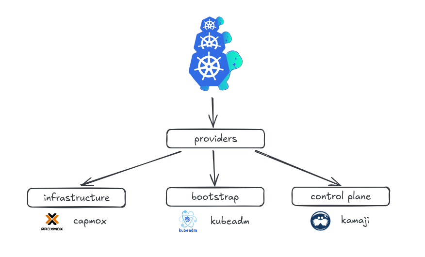
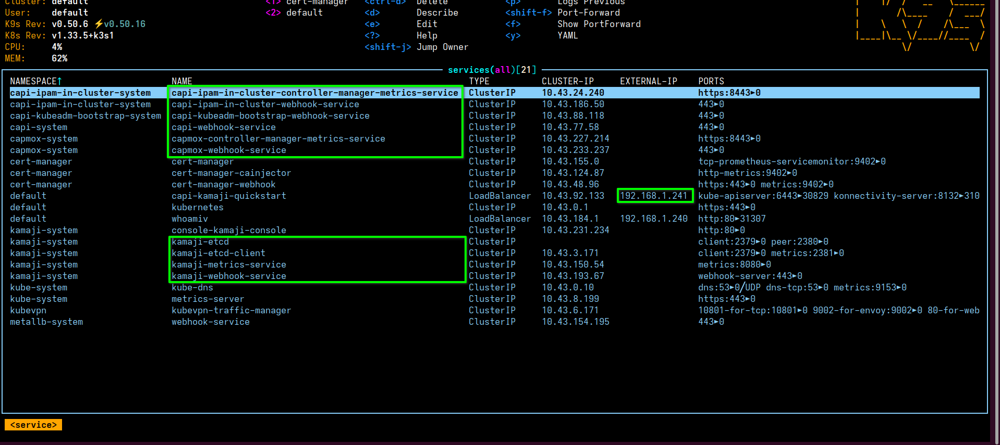
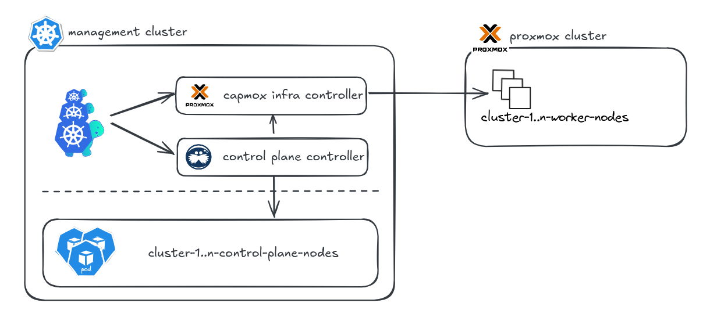
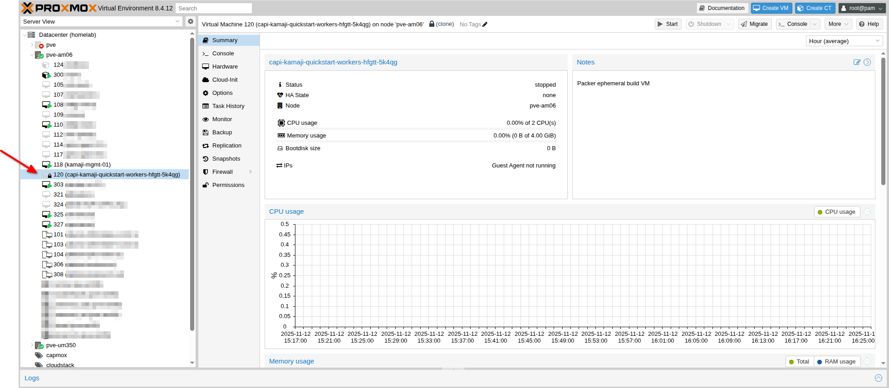
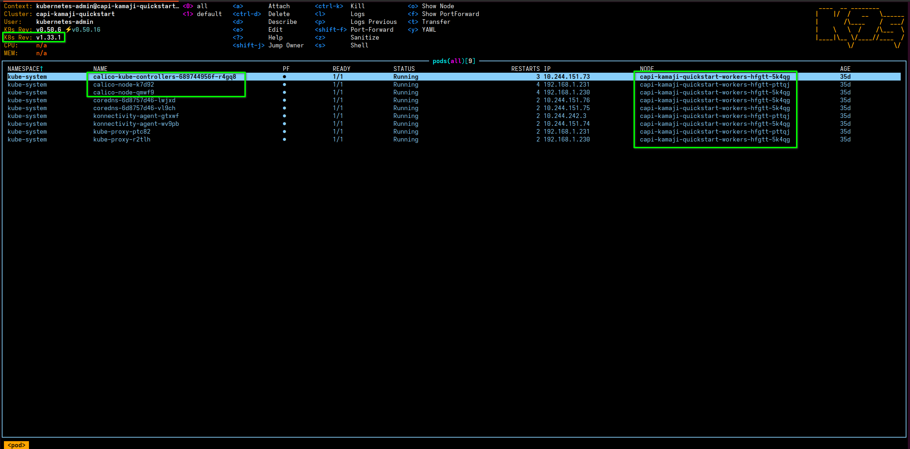
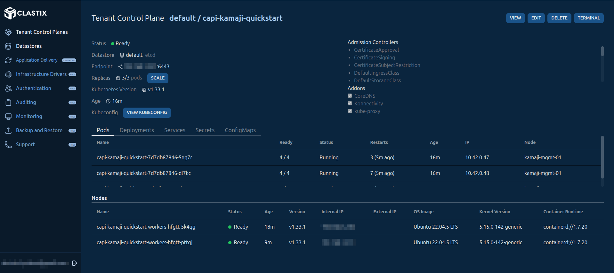

> *⚠️* If you are new to [Cluster API (CAPI)](https://github.com/kubernetes-sigs/cluster-api), please refer to my previous article, [Build your own Managed Kubernetes Service on Proxmox with CAPI](/blog/managed-kubernetes-proxmox-capi), for a detailed introduction.

## Prerequisites

For this lab you need to bring with:

1. a single-node or even better a multi-node [Proxmox](https://www.proxmox.com/) cluster. *Installing and configuring the Proxmox cluster itself is* ***out*** *of the scope of this article*.
2. Relevant hands-on experience on Proxmox and Kubernetes.
3. Relevant hands-on experience with CAPI.
4. A workstation with homebrew, kubectl, [clusterctl](https://cluster-api.sigs.k8s.io/clusterctl/overview.html).
5. A virtual machine with [k3s](https://k3s.io/) (4 vCPUs, 6GB RAM no ballooning) for implementing the Kamaji part of the lab (In this case, the management cluster cannot be illustrated using [kind](https://kind.sigs.k8s.io/), unlike in the previous article.

> *⚠️* This lab requires Proxmox version `8.4.12`. Earlier versions exhibit issues with the integration with the [CAPMOX](https://github.com/ionos-cloud/cluster-api-provider-proxmox) provider, and later versions have not been tested by this guide.

In this lab we are going to demonstrate how you could create your own Managed Kubernetes Service using CAPI with Proxmox as infrastructure provider, [kubeadm](https://kubernetes.io/docs/reference/setup-tools/kubeadm/) as bootstrap provider and for the role of control plane provider we are going to use [Kamaji](https://kamaji.clastix.io/).



## What is Kamaji?

[Kamaji](https://github.com/clastix/kamaji) is an open-source project developed by [Clastix](https://clastix.io/) that implements the Kubernetes control plane as a hosted service running entirely on Kubernetes itself. Instead of provisioning dedicated virtual machines or bare-metal servers for etcd, kube-apiserver, the controller manager, and the scheduler, Kamaji runs these components as Pods within a management cluster and exposes them to tenant clusters through a lightweight API. This hosted control plane model decouples control plane lifecycle management from the underlying infrastructure, significantly reducing operational overhead and resource duplication.

Under the hood, Kamaji introduces two new API groups. The `TenantControlPlane` resource, which defines the desired configuration for a control plane: Kubernetes version, certificate settings, replica count, scheduling constraints and exposure method (ClusterIP, LoadBalancer or NodePort). Separately, a `DataStore` resource manages the backing store for one or more tenant control planes, which is by default [etcd](https://etcd.io/), but optionally other better scaling alternatives such as MySQL, PostgreSQL or NATS (via Kine) can used as a replacement.

## Preparing your Proxmox Users and API Tokens

> *❗️*You can skip this section if you have already completed the setup by following the steps outlined in the previous article.

Before we can build images, the image-builder needs permission to interact with your Proxmox environment through its API. This access allows it to launch a virtual machine, perform the build process, and then turn that VM into a reusable template. Execute the following command in one of your Proxmox nodes:


```bash
pveum user add image-builder@pve
pveum aclmod / -user image-builder@pve -role PVEAdmin
pveum user token add image-builder@pve capi -privsep 0
pveum user add capmox@pve
pveum aclmod / -user capmox@pve -role PVEAdmin
pveum user token add capmox@pve capi -privsep 0
```


## Building Images for Proxmox with image-builder

> *‼️*Given that this is a quite lengthy configuration step, and to avoid cluttering the article or making it unnecessarily long, please refer to the corresponding section in the previous article, if you have not already completed it. Otherwise, you can safely skip this step.

## Installing Prerequisites

> To maintain a single guide for both macOS and Linux, we’ll use [Homebrew](https://brew.sh/) to install the binaries required for managing the cluster.

1️⃣ Install Homebrew


```bash
/bin/bash -c "$(curl -fsSL https://raw.githubusercontent.com/Homebrew/install/HEAD/install.sh)"
```


Follow the instructions of the installer, to complete the installation.

2️⃣ Install kubectl


```bash
brew install kubectl
```


3️⃣ Install clusterctl


```bash
brew install clusterctl
```


> *⚠️* This lab requires clusterctl version `v1.11.3` or later.

The `clusterctl` CLI delivers a streamlined “day one” experience for CAPI by automatically retrieving and installing the necessary provider manifests. It embeds recommended best practices for provider management, helping you avoid mis-configurations and simplifying tasks like upgrades.

Built on top of `clusterctl`, the Cluster API Operator is a Kubernetes operator that brings a fully declarative workflow for managing provider lifecycles within your management cluster. It enhances the deployment and day-to-day operation of Cluster API, making routine tasks and GitOps-driven automation effortless.

## Create Configuration for Proxmox

Create a a file named `capmox.env`, and fill it in with the following content:


```bash
export PROXMOX_URL="https://<PROXMOX_NODE_IP>:8006"
export PROXMOX_TOKEN='capmox@pve!capi'
export PROXMOX_SECRET="<CAPMOX_API_TOKEN_SECRET>"                          
export PROXMOX_SKIP_TLS_VERIFY="true"
```


> Replace every occurrence of `<PROXMOX_NODE_IP>` with the IP address and CIDR corresponding to your bridge interface (`vmbr0`, for this lab).

> Do the same for `<CAPMOX_API_TOKEN_SECRET>`, using the appropriate value for your environment.

## Setting up a Management Cluster

This is the cluster that runs one or more Infrastructure Providers and holds resources (for example, `Machines`), when provisioning multiple workload clusters.

⏩ **SSH into the virtual machine that will host the K3s cluster.**

1️⃣ Create the cluster


```bash
curl -sfL https://get.k3s.io | INSTALL_K3S_EXEC="--disable traefik --disable servicelb" sh -

sudo chmod 644 /etc/rancher/k3s/k3s.yaml
sudo cp /etc/rancher/k3s/k3s.yaml ~/.kube/config
sudo chown <USER>:<USER> ~/.kube/config
```


> Replace `<USER>` with the appropriate user and group for your environment.

If the management cluster is running on a different virtual machine, copy `~/.kube/config` to your bootstrap machine where the required prerequisites (Homebrew, kubectl, and clusterctl) are already installed.

> Make sure you change the `server` value from `https://127.0.0.1:6443` to the IP address assigned on the network device that uses the bridge `vmbr0`.

⏩ **Switch now to your bootstrap machine.**

2️⃣ Install Cert-Manager

Kamaji relies on Kubernetes dynamic admission control mechanisms, including validating and mutating webhook configurations. These webhooks communicate over TLS, with certificates managed by [cert-manager](https://github.com/cert-manager/cert-manager), which therefore must be installed as a prerequisite.


```cpp
helm repo add jetstack https://charts.jetstack.io
helm repo update

helm install \
  cert-manager jetstack/cert-manager \
  --namespace cert-manager \
  --create-namespace \
  --set installCRDs=true
```


3️⃣ Install the Kamaji Operator


```bash
helm repo add clastix https://clastix.github.io/charts
helm repo update

helm install kamaji clastix/kamaji \
    --version 0.0.0+latest \
    --namespace kamaji-system \
    --create-namespace \
    --set image.tag=latest
```


4️⃣ Install MetalLB

> *⚠️* Kamaji provisions the control plane as a set of Pods exposed through a Service. This Service must be assigned an IP address within the network defined by the `vmbr0` interface so that it is reachable by worker nodes and by consumers of the cluster. For this reason, a solution such as [MetalLB](https://github.com/metallb/metallb) is required. Other alternatives may also be suitable; e.g., [kube-vip](https://github.com/kube-vip/kube-vip) or [klipper](https://github.com/k3s-io/klipper-lb) the embedded K3s service load balancer which in our case would mean you need to reinstall the cluster, since it was provisioned **without** Traefik and Klipper.


```yaml
kubectl apply -f https://raw.githubusercontent.com/metallb/metallb/v0.14.3/config/manifests/metallb-native.yaml

kubectl apply -f - <<EOF
apiVersion: metallb.io/v1beta1
kind: IPAddressPool
metadata:
  name: default-pool
  namespace: metallb-system
spec:
  addresses:
  - 192.168.1.240-192.168.1.250
---
apiVersion: metallb.io/v1beta1
kind: L2Advertisement
metadata:
  name: default-advertisement
  namespace: metallb-system
spec:
  ipAddressPools:
    - default-pool
EOF
```


> ️Replace the IP address pool range, in this case `192.168.1.240–192.168.1.250`, so it matches your environment. Ensure that the selected IP range belongs to the `vmbr0` interface network.

5️⃣ Transform the cluster to a Management Cluster

With clusterctl installed and prerequisites satisfied, run `clusterctl init` to convert your Kubernetes cluster into a management cluster.


```bash
source capmox.env

clusterctl init \
  --infrastructure proxmox \ 
  --ipam in-cluster \ 
  --control-plane kamaji
```


> The command above will install [Cluster API Provider for Proxmox VE](https://github.com/ionos-cloud/cluster-api-provider-proxmox/) (CAPMOX) as infrastructure provider, Kubeadm as bootstrap provider and Kamaji as control-plane provider.



## Creating a Cluster with the Kamaji CP Provider

When you use a `KamajiControlPlane` alongside your `Cluster` and `Machine` objects, the Kamaji control-plane provider watches for that resource and **spins up the Kubernetes control-plane components as Pods in your management cluster**. It provisions etcd, generates and rotates certificates, and configures the API server, controller-manager and scheduler according to the specs in the `KamajiControlPlane`. As Pod replicas become ready, Kamaji wires them into a highly available endpoint and exposes it (ClusterIP, LoadBalancer or NodePort), while your worker nodes simply run `kubeadm join` against that hosted control plane, giving you **a fully managed, multi-tenant control plane without requiring dedicated VMs**.


\*Multiple Control Planes are running as Kubernetes Pods while their Worker Nodes are Proxmox VMs .\*

1️⃣ Create Configuration for Kamaji

Before creating a tenant Kubernetes cluster, some configuration is required on the management cluster for Kamaji. Create a a file named `kamaji.env`, and fill it in with the following content:


```bash
# Cluster Configuration
export CLUSTER_NAME="capi-kamaji-quickstart"
export CLUSTER_NAMESPACE="default"
export CONTROL_PLANE_REPLICAS=3
export KUBERNETES_VERSION="v1.33.1"
export CLUSTER_DATASTORE="default"

# Networking Configuration
export IP_RANGE='["192.168.1.230-192.168.1.239"]'
export IP_PREFIX=24
export GATEWAY="192.168.1.1"
export DNS_SERVERS='["192.168.1.1","8.8.8.8"]'
export NETWORK_BRIDGE="vmbr0"
export NETWORK_MODEL="virtio"

# Node Configuration
export SSH_USER="<USER>"
export SSH_AUTHORIZED_KEY="ssh-rsa AAAAB..."
export NODE_REPLICAS=2
export NODE_LABELS=
export NODE_TAINTS=

# Resource Configuration
export SOURCE_NODE="pve-01"
export TEMPLATE_ID=101
export ALLOWED_NODES='["pve-01", "pve-02"]'
export MEMORY_MIB="2048"                                            
export NUM_CORES=2
export NUM_SOCKETS=1
export BOOT_VOLUME_DEVICE="scsi0"
export BOOT_VOLUME_SIZE=20
export FILE_STORAGE_FORMAT="raw"
export STORAGE_NODE="local-lvm"

export CLOUD_INIT_CONFIG="#cloud-config package_update=true packages=- net-tools"
```


> Replace `IP_RANGE`, `GATEWAY`, `DNS_SERVERS`, `NETWORK_BRIDGE`, `SSH_USER`, `SSH_AUTHORIZED_KEY`, `SOURCE_NODE`, `TEMPLATE_ID`, `ALLOWED_NODES` values and any other variable for that matter, so they match **your** environment.

2️⃣ Generate the manifests

Download the `capi-kamaji-proxmox-template.yaml` template file and save it in your working directory, then use the following commands to generate a cluster manifest from this template.


```bash
source kamaji.dev 

clusterctl generate cluster $CLUSTER_NAME \
    --from capi-kamaji-proxmox-template.yaml \
    > capi-kamaji-proxmox-cluster.yaml
```


3️⃣ Allow CAPMOX to over-commit memory ⚠️

When the infrastructure controller provisions a new VM on Proxmox, it first sums the RAM already allocated on the target host to determine if your `MachineTemplate` will fit. If you haven’t explicitly enabled memory over-commit, this check will refuse to schedule any VM once the sum of allocated RAM reaches the node’s nominal capacity, causing new VMs to hang even though Proxmox could safely oversubscribe memory in practice.

For that matter, add the following properties to the `ProxmoxCluster` resource:


```yaml
schedulerHints:
    memoryAdjustment: 0
```


For example:


```yaml
apiVersion: infrastructure.cluster.x-k8s.io/v1alpha1
kind: ProxmoxCluster
metadata:
  labels:
    cluster.x-k8s.io/cluster-name: tenant-01-kamaji
  name: tenant-01-kamaji
  namespace: default
spec:
  ...
  dnsServers:
    - 192.168.1.1
    - 8.8.8.8
  ...
  schedulerHints:
    memoryAdjustment: 0
```


4️⃣ Create the cluster

Execute the command:


```bash
kubectl apply -f capi-kamaji-proxmox-cluster.yaml
```



\*The worker nodes are being provisioned in Proxmox.\*

This process will take a few minutes. Once it completes, retrieve the **kubeconfig** file for the newly created cluster by running:


```bash
clusterctl get kubeconfig capi-kamaji-quickstart > capi-kamaji-quickstart.kubeconfig
```


5️⃣ Deploy a CNI

For demonstration purposes, [Calico](https://docs.tigera.io/calico/latest/about/) will be deployed as the CNI for the newly created cluster. In your lab, you may choose a different CNI if preferred. Execute the following command:


```bash
kubectl --kubeconfig=./capi-kamaji-quickstart.kubeconfig \
  apply -f https://raw.githubusercontent.com/projectcalico/calico/v3.26.1/manifests/calico.yaml
```


> *When issues arise, you can access any node directly by opening an SSH session as the* `root` *user. This allows you to inspect system logs, review configuration files, and run diagnostic commands on each machine.*


\*The workload cluster is now ready for use!\*

6️⃣ Install Kamaji Console (Optional)

The [**Kamaji Console**](https://kamaji.clastix.io/guides/console/) is a web-based user interface provided by the Kamaji project to observe and manage hosted Kubernetes control planes managed by Kamaji. There is limited functionality available in the free version, but it is included here for completeness.

Before installing the console, you must provision the required Secret:


```yaml
cat <<EOF | kubectl apply -f -
apiVersion: v1
kind: Secret
type: Opaque
metadata:
  name: kamaji-console
  namespace: kamaji-system
data:
  ADMIN_EMAIL: <ADMIN_EMAIL>
  ADMIN_PASSWORD: <ADMIN_PASSWORD>
  JWT_SECRET: <JWT_SECRET>
  NEXTAUTH_URL: <NEXTAUTH_URL>
EOF
```


> Replace all values of the variables under the `data` stanza so they match **your** environment.

And then install the console via its Helm Chart:


```javascript
helm repo add clastix https://clastix.github.io/charts
helm repo update

helm install console clastix/kamaji-console -n kamaji-system
```



## Next Steps

In the next article, we will explore how to use Kamaji together with tools such as [ArgoCD](https://argo-cd.readthedocs.io/en/stable/) and [Sveltos](https://sveltos.projectsveltos.io/) to take advantage of the automation capabilities provided by GitOps.

Originally published on [Medium](https://medium.com/itnext/build-your-own-managed-kubernetes-service-on-proxmox-with-capi-and-kamaji-7858ad41cb09)