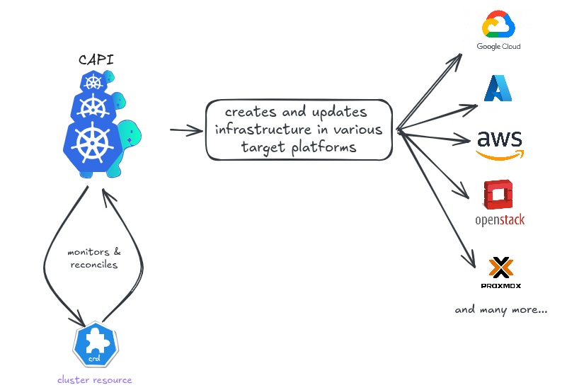
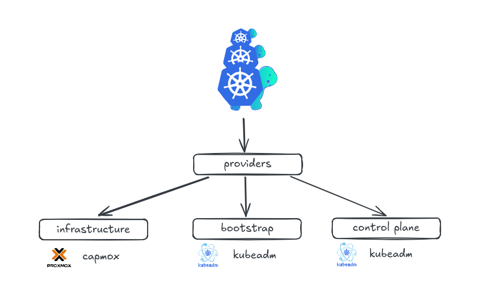
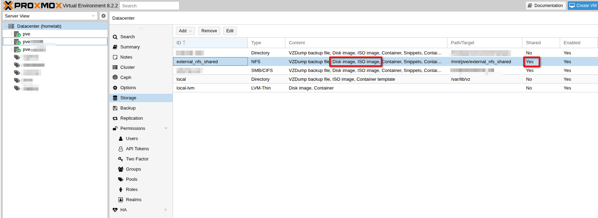
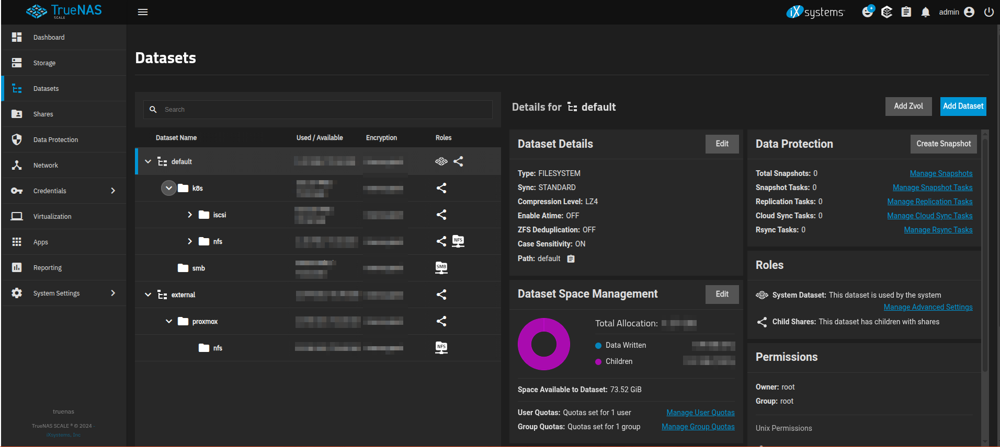
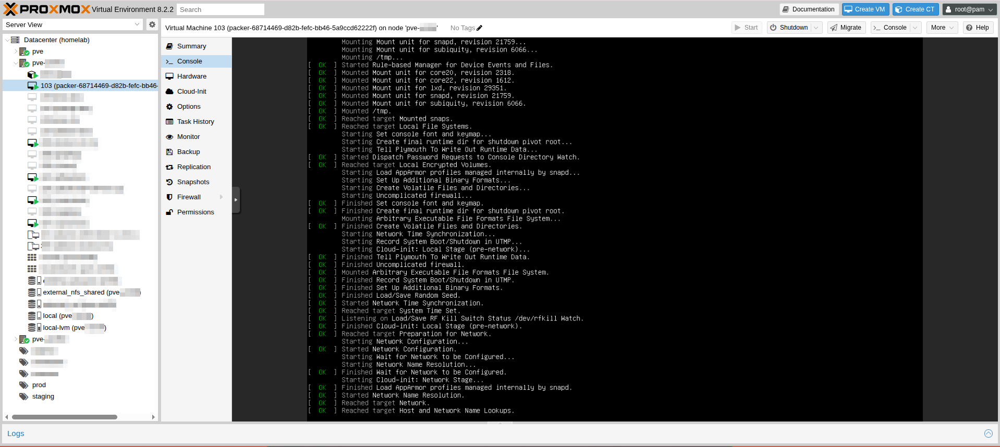
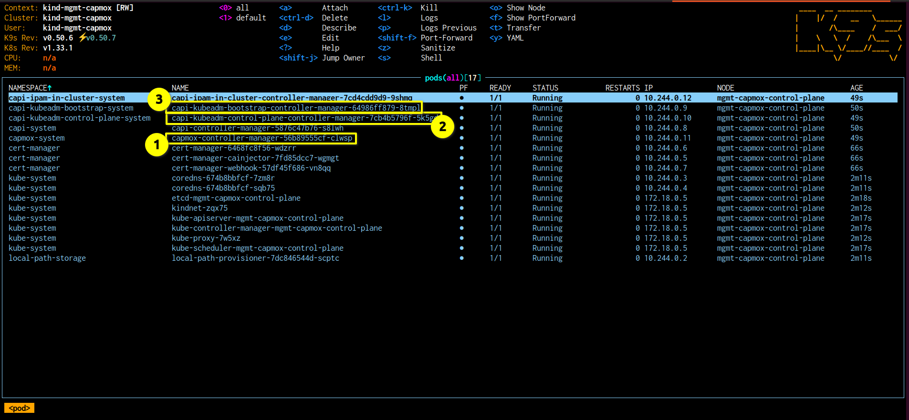
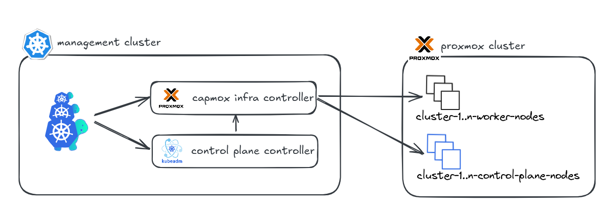
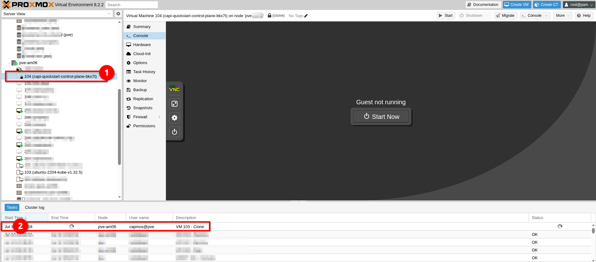
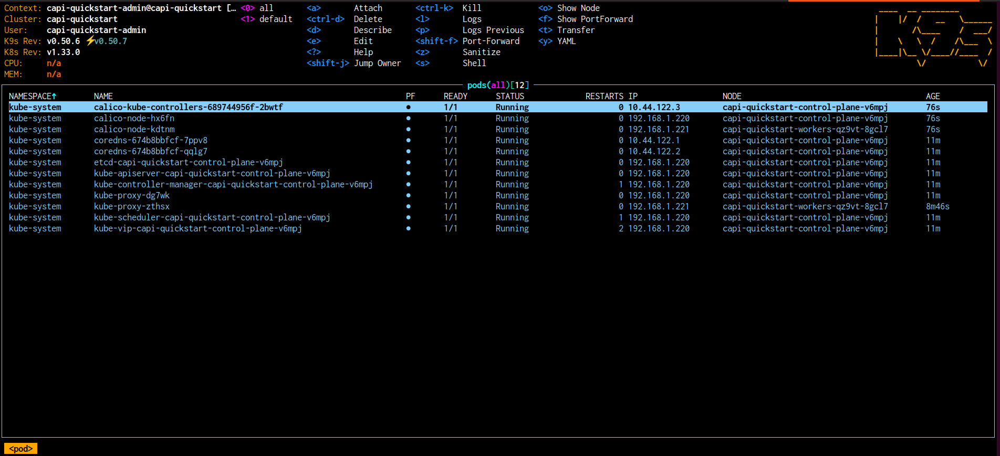

import { Aside } from 'astro-pure/user'

## What is CAPI?

[Cluster API](https://github.com/kubernetes-sigs/cluster-api) (CAPI) is an open-source Kubernetes sub-project. Its goal is to bring Kubernetes-style, declarative APIs and controllers to the problem of bootstrapping, configuring, upgrading and operating entire Kubernetes clusters, treating clusters themselves (and the machines that compose them) as first-class Kubernetes resources rather than as external, manually-provisioned infrastructure.

CAPI is deployed to a Kubernetes cluster, it leverages your familiar toolchain (kubectl, CRDs, manifests) to manage clusters at scale. When you request a new cluster, via a new custom resource named `Cluster`, a **provider-specific controller** provisions the necessary resources in the target infrastructure. As cluster demands change or when upgrades are required, simply updating the Kubernetes manifests and reapplying them triggers rolling updates or scale-out operations, all managed by the same reconciliation loops that govern standard Kubernetes workloads.



Adopting CAPI brings consistency and repeatability to cluster operations. Cluster operators can define golden-image references, networking topologies and scaling policies in version-controlled manifests. The reconciliation-driven approach ensures that drift is corrected automatically, while upgrade strategies (for example, in-place control-plane upgrades followed by a rolling reboot of worker nodes) can be codified and reused. This makes Cluster API especially valuable for organizations managing hundreds of clusters across multiple teams, regions or infrastructure providers, including public clouds and on-premises environments.

## How is CAPI working?

CAPI is built around a few key abstractions and components that work together to model and manage Kubernetes clusters declaratively. At a high level, you have:

### Management & Workload Clusters

A *management cluster* is a regular Kubernetes control plane where the CAPI controllers run. It holds all of the Cluster API Custom Resources (CRs) and drives the lifecycle of one or more *workload clusters;* the actual Kubernetes clusters you are going to use for running your applications.

### Custom Resource Definitions (CRDs)

CAPI introduces its own CRDs to represent clusters and the machines that comprise them:

- `Cluster`**:** The top-level object defining a Kubernetes cluster (networking, Kubernetes version, etc.).
- `Machine`, `MachineSet` and `MachineDeployment`**:** Machines map to individual VMs or bare-metal hosts. A MachineSet ensures a stable number of Machines, while a MachineDeployment provides rolling-update semantics over MachineSets (much like a Deployment for Pods).
- `ControlPlane`: Encapsulates control-plane-specific settings (certificate management, high-availability, version upgrades) and drives creation or scaling of control-plane Machines (the default ControlPlane provider is `KubeadmControlPlane`).
- `MachineHealthCheck`: Defines criteria for identifying unhealthy Nodes and triggers automatic replacement of the corresponding Machines.

### Provider Components

The reconciliation logic is split, abstracted and delegated into three **pluggable** provider types, each implemented by its very own controller manager:

- **Infrastructure provider:** Talks to the target cloud or virtualization API (AWS, Azure, GCP, OpenStack, Proxmox, VMware etc.) to create and delete VMs, networks, load balancers and related resources.

  <Aside type="tip">
  You can find an indicative, but not extensive list, of the most common providers here: https://image-builder.sigs.k8s.io/capi/capi#providers
  </Aside>

- **Bootstrap provider:** Prepares a newly-provisioned VM to become a Kubernetes Node: generating certs, initializing the control plane on the first Machine, and running `kubeadm join` on subsequent control-plane or worker Machines.
- **ControlPlane provider:** Manages the lifecycle of control-plane Machines themselves (implementing rolling upgrades of API servers via e.g.`KubeadmControlPlane`).

### Controllers & Reconciliation

For each CRD, a corresponding controller watches the `.spec` you declare, compares it to the actual state in the cloud and Kubernetes, and takes actions to converge them. If you increase the replica count of a`MachineDeployment`, the `MachineDeployment` controller will create a new `MachineSet` (or update an existing one), which in turn lets the Infrastructure and Bootstrap controllers provision and join new VMs. If someone manually deletes a VM, the next reconciliation cycle notices the missing Machine object and reprovisions it automatically. Finalizers ensure that when you delete a `Cluster` resource, machines and cloud resources are torn down in the proper order before the `Cluster` object is removed.

## Prerequisites

For this lab you need to bring with:

1. a [Proxmox](https://www.proxmox.com/) installation (single-node or even better a multi-node cluster). *Installing and configuring Proxmox is* ***out*** *of the scope of this article*.
2. Relevant hands-on experience on Proxmox and Kubernetes.
3. A workstation with homebrew, kubectl, clusterctl and kind.
4. A virtual machine with [k3s](https://k3s.io/) for implementing the management cluster.

In this lab we are going to demonstrate how you could create your own Managed Kubernetes Service using CAPI with Proxmox as infrastructure provider, kubeadm as bootstrap provider and for the role of control plane provider we are going to use **kubeadm**.





## Preparing your Proxmox Users and API Tokens

Before we can build images, the image-builder needs permission to interact with your Proxmox environment through its API. This access allows it to launch a virtual machine, perform the build process, and then turn that VM into a reusable template. Execute the following command in one of your Proxmox nodes:


```bash
pveum user add image-builder@pve
pveum aclmod / -user image-builder@pve -role PVEAdmin
pveum user token add image-builder@pve capi -privsep 0

pveum user add capmox@pve
pveum aclmod / -user capmox@pve -role PVEAdmin
pveum user token add capmox@pve capi -privsep 0
```


## Building Images for Proxmox with image-builder

With [image-builder](https://github.com/kubernetes-sigs/image-builder) we try to standardize and automate the creation of virtual machine images that are pre-configured for Kubernetes and Cluster API, ensuring consistency, security, and speed during cluster provisioning. Rather than relying on untested or manually assembled OS snapshots, image-builder uses declarative “recipes” (built with tools like [Packer](https://developer.hashicorp.com/packer) and [Ansible](https://www.redhat.com/en/ansible-collaborative)) to bake in all the required components as kernel settings, container runtime, kubeadm binaries, networking plugins, and any custom security hardening into one baseline image. These images then serve as the immutable base for all control-plane and worker nodes, eliminating variability and drift across environments.

By producing provider-specific artifacts, image-builder decouples the image creation lifecycle from cluster creation. The result is faster cluster bootstraps, reproducible upgrades aligned to Kubernetes versions, and a GitOps-friendly workflow where image updates propagate through your pipelines just like application code.

So let’s perform the following steps to install, configure and create or base line with the image-builder:

1️⃣ Clone (or fork and clone) the repo in your workstation:


```bash
git clone git@github.com:kubernetes-sigs/image-builder.git
cd image-builder/images/capi
```


2️⃣ Install the dependencies:

In order to install the dependencies automatically execute the following command:

```bash
make deps
```

This will install dependencies in the folder`image-builder/images/capi/.bin` (if they are not already on your system). Then you need to add that to your `PATH` environment variable before they can be used:

```bash
export PATH=$PWD/.bin:$PATH
```

3️⃣ Configure for Proxmox

Add a new file at`image-builder/images/capi/packer/proxmox/.env` and provide the required environment variables, replacing with your own values where necessary:

```typescript
export PROXMOX_URL="https://<PROXMOX_NODE_IP>:8006/api2/json"
export PROXMOX_USERNAME=image-builder@pve!capi
export PROXMOX_TOKEN=<IMAGE_BUILD_API_TOKEN>
export PROXMOX_NODE="<PROXMOX_NODE_NAME>"
export PROXMOX_ISO_POOL="local"
export PROXMOX_STORAGE_POOL="<PROXMOX_STORAGE_POOL>"
export DISK_FORMAT="<DISK_FORMAT>"
```


```text
export PROXMOX_BRIDGE="vmbr0"
export PROXMOX_NIC_MODEL="virtio"
```

<Aside type="caution">
If you are working with OPNSense, image-builder is not 
assigning a Proxmox MAC address to the VM, and this seems 
to be an issue with DHCP in VXLANs controlled by OPNSense!
In theory you can configure your MTU and VLAN tag with the 
following variables. **For the time being leave them commented**:

```text
# export PROXMOX_MTU="1450"
# export PROXMOX_VLAN="23"
```

Make sure you add the `.env` file in your `.gitignore` in order to avoid leaking API tokens when you commit the changes to your repo (if you have forked it in the first place).

The environment variables `PROXMOX_ISO_POOL`, `PROXMOX_BRIDGE`,`PROXMOX_STORAGE_POOL` here are optional, just to demonstrate how to override the default values, because we might need to adjust some of them later on for a multi-node Proxmox cluster scenario.
</Aside>

```text
export PACKER_FLAGS="--var memory=2048 --var 'kubernetes_rpm_version=1.32.5' --var 'kubernetes_semver=v1.32.5' --var 'kubernetes_series=v1.32' --var 'kubernetes_deb_version=1.32.5-1.1'"
```

If you want to bake an image for a specific Kubernetes version (or pass specific variables to parameterize the baseline image) use the `PACKER_FLAGS` variable. You can omit altogether but I don’t recommend it until you fully grasp how image-builder utilizes Packer behind the scenes.

4️⃣ Configure `PROXMOX_STORAGE_POOL` and `DISK_FORMAT`

If you are running on a **single-node Proxmox** installation you need to set `PROXMOX_STORAGE_POOL` value to `local-lvm`. Consequently, because `local-lvm` is not accepting `qcow2` disk formats, you need to set `DISK_FORMAT` value to `raw`.

If, on the other hand, you are running a **multi-node Proxmox cluster**, you need to set `PROXMOX_STORAGE_POOL` value as the name of a storage **that can be shared among nodes,** otherwise you will not be able to spin control-plane and worker nodes on other nodes than the one you uploaded your baseline image. In addition to that, you have to configure that very storage to accept `qcow2` format. Set `DISK_FORMAT` value to `qcow2`.

<Aside type="tip" title="A SHORT SIDE-QUEST">
In my case, I run a [TrueNAS](https://www.truenas.com/) server as a virtual machine in one of the Proxmox nodes and I expose an NFS share which I add as storage in Proxmox (funny circle I know; performance is not great so I do recommend building an external NAS if you have the budget).



Installing a separate TrueNAS, is an effort worth investing in, as you could externalize **all** the storage demands of **all** your Kubernetes clusters to TrueNAS by using [democratic-csi](https://github.com/democratic-csi/democratic-csi) as CSI (but this is way out of the scope of this article, maybe I will write it up in a separate article in the future).



</Aside>

5️⃣ Adjust Packer Template

We are going to make some adjustments in the file that Packer is using to create the baseline image, as it is missing some details that come in very handy when working with Proxmox.

Some of them are just missing, others just regulate the hardware specs that we are going to demand for our base line image template. So open the file below `image-builder/images/capi/packer/proxmox/packer.json.tmpl`:

Add in `network_adapters` and new property called `model`, as shown in the snippet below:


```json
"network_adapters": [
```


Under `variables`, add:


```json
"nic_model": "{{env `PROXMOX_NIC_MODEL`}}",
```


change (remove or append according to -/+ prefixes):


```json
- "disk_format": "qcow2",
```


6️⃣ Build Image

Execute the following commands:


```bash
source packer/proxmox/.env
make build-proxmox-ubuntu-2204
```


That will build a base image for your control-plane and worker nodes, based on Ubuntu 22.04; the process takes quite some time (~25–35mins depending on the specs of your workstation, your internal & external networks speed etc) so sit back and wait for it. In the meantime you can open your Proxmox console and observe how a new virtual machine is being created, gets its network configuration, package updates, and eventually having installed (via Ansible) all the necessary binaries that will make it suitable to serve as a Kubernetes node. When all fine tuning is complete, it will be automatically converted to a template.





## Installing Prerequisites

To maintain a single guide for both macOS and Linux, we’ll use [Homebrew](https://brew.sh/) to install the binaries required for managing the cluster.

1️⃣ Install Homebrew


```bash
/bin/bash -c "$(curl -fsSL https://raw.githubusercontent.com/Homebrew/install/HEAD/install.sh)"
```


Follow the instructions of the installer, to complete the installation.

2️⃣ Install KiND


```bash
brew install kind
```


3️⃣ Install kubectl


```wasm
brew install kubectl
```


4️⃣ Install clusterctl


```bash
brew install clusterctl
```


The `clusterctl` CLI delivers a streamlined “day one” experience for CAPI by automatically retrieving and installing the necessary provider manifests. It embeds recommended best practices for provider management, helping you avoid mis-configurations and simplifying tasks like upgrades.

Built on top of `clusterctl`, the Cluster API Operator is a Kubernetes operator that brings a fully declarative workflow for managing provider lifecycles within your management cluster. It enhances the deployment and day-to-day operation of Cluster API, making routine tasks and GitOps-driven automation effortless.

## Create Configuration for Proxmox

Before creating a workload cluster, certain configurations required on your management cluster. This is done by setting up environment variables for the [Cluster API Provider for Proxmox VE](https://github.com/ionos-cloud/cluster-api-provider-proxmox/) (CAPMOX) and then generating a cluster manifest.

Create a a file named `capmox.env`, and fill it in with the following content:


```bash
## -- Controller settings -- ##
export PROXMOX_URL="https://<PROXMOX_NODE_IP>:8006"
export PROXMOX_TOKEN='capmox@pve!capi'
export PROXMOX_SECRET="<CAPMOX_API_TOKEN_SECRET>"                          
```


```text
## -- Required workload cluster default settings -- ##
export PROXMOX_SOURCENODE="<PROXMOX_SOURCENODE_NAME>"                                     
export TEMPLATE_VMID="<PROXMOX_BASE_IMAGE_TEMPLATE_ID>"                                          
export ALLOWED_NODES="[<PROXMOX_NODE1_NAME>,<PROXMOX_NODE2_NAME>...]"
export VM_SSH_KEYS="ssh-rsa AAAAB..."
```


```text
## -- networking configuration-- ##
export CONTROL_PLANE_ENDPOINT_IP="192.168.1.230"                    
export NODE_IP_RANGES="[192.168.1.220-192.168.1.229]"               
export GATEWAY="192.168.1.1"                                        
export IP_PREFIX="24"                                               
export DNS_SERVERS="[192.168.1.1]"                                  
export BRIDGE="vmbr0"
export NETWORK_MODEL="virtio"                                       
```


```text
## -- xl nodes -- ##
export BOOT_VOLUME_DEVICE="scsi0"                                   
export BOOT_VOLUME_SIZE="20"                                       
export NUM_SOCKETS="1"                                              
export NUM_CORES="2"                                                
export MEMORY_MIB="2048"                                            
export FILE_STORAGE_FORMAT="raw"
export STORAGE_NODE="local-lvm"
export NODE_REPLICAS=1
```


```text
export CLOUD_INIT_CONFIG="#cloud-config package_update=true packages=- net-tools"## -- Controller settings -- ##
```

<Aside type="note">
Replace all the `192.168.1.0/24` IP address with the CIDR that matches your the bridge interface`vmbr0`, or whichever bridge you chose to use for that matter.

Replace all the values in placeholders with the ones corresponding in your lab.
</Aside>

## Setting up a Management Cluster

This is the cluster that runs one or more Infrastructure Providers and holds resources (for example, `Machines`), when provisioning multiple workload clusters.

1️⃣ Create the cluster

Create a kind config file named `kind-management-cluster.yaml`, with extra mounts to allow the Docker provider to access Docker on the host:


```yaml
kind: Cluster
```


and execute the following command:


```bash
kind create cluster --name=mgmt-capmox --config=kind-management-cluster.yaml
```


the kubeconfig of the newly generated cluster is already merged with your `KUBECONFIG` and your kubectl is automatically set to use its context.

If you are planning to try Kamaji as control-plane provider, install the management cluster, using [K3s](https://k3s.io/), in a brand new virtual machine (that either uses the same bridge, `vmbr0` in our lab, as the one you used above or one that can communicate with `vmbr0`) , by executing the following command:


```bash
curl -sfL https://get.k3s.io | INSTALL_K3S_EXEC="--disable=traefik --disable=servicelb" sh -
```


You can find the kubeconfig of the newly created cluster under `/etc/rancher/k3s/k3s.yaml`. Copy it somewhere in your workstation (preferably under `~/.kube/k3s.yaml`) and run:


```bash
export KUBECONFIG=~/.kube/k3s.yaml
```

<Aside type="note">
Make sure you change the server value from `https://127.0.0.1:6443` to the IP address assigned on the network device that uses the bridge `vmbr0`.
</Aside>

2️⃣ Transform the cluster to a Management Cluster

With clusterctl installed and prerequisites satisfied, run `clusterctl init` to convert your Kubernetes cluster into a management cluster.


```bash
source capmox.env
```

<Aside type="note">
The command above will install [Cluster API Provider for Proxmox VE](https://github.com/ionos-cloud/cluster-api-provider-proxmox/) (CAPMOX) as infrastructure provider and Kubeadm as control-plane & bootstrap provider.
</Aside>



*1. Infrastructure Provider (Proxmox) 2. Control-Plane Provider (Kubeadm) 3. Bootstrap Provider (Kubeadm)*

## Creating a Cluster with Kubeadm CP Provider

The kubeadm control plane provider watches `KubeadmControlPlane` resources in your management cluster and drives the lifecycle of control-plane nodes. When you create or update a `KubeadmControlPlane`, the provider generates a corresponding set of `Machine` objects (using your `MachineTemplate`) and orchestrates `kubeadm init` on the first node, then `kubeadm join` for additional replicas.

It manages certificate generation and rotation, handles rolling upgrades by replacing one control-plane node at a time, and ensures the Kubernetes API servers remain available throughout. All configuration (Kubernetes version, component settings, high-availability topology) is defined declaratively in the `KubeadmControlPlane` spec, and the provider’s reconciliation loop converges the actual state to match.

When using the kubeadm control plane provider with the Proxmox infrastructure provider (CAPMOX), the control plane controller creates `Machine` objects **whose underlying VMs are provisioned on Proxmox** according to your `MachineTemplate`. As each VM becomes available, the kubeadm provider runs `kubeadm init` on the first node and `kubeadm join` on subsequent replicas, while Proxmox handles the VM lifecycle, boot, networking, and storage. This integration lets you declaratively manage high-availability control planes on your Proxmox cluster using the familiar CAPI workflows.




*Multiple Control Planes and Worker Nodes are running as VMs in Proxmox*


1️⃣ Generate the manifests

The `clusterctl generate cluster` command returns a YAML manifest for creating a workload cluster.


```bash
source capmox.env
```


This creates a manifest called`capi-quickstart.yaml` with a predefined list of CAPI resources as `Cluster`, `Machines` and `MachineDeployments`, etc. The generated file has some issues when it comes to play with Proxmox as target infrastructure and we have to make some manual changes.

2️⃣ Change the CIDR block of the `Cluster` object ⚠️

You need to change the `cidrBlock` value to something not overlapping with the CIDR block of your `vmbr0` bridge (in this case, yours might differ) otherwise your Pods will starts stealing IP addresses from that network segment. So go and replace the value, I choose in my case a CIDR I know that I am not using somewhere else either in a physical or virtual LAN, `10.44.0.0/16`.


```yaml
apiVersion: cluster.x-k8s.io/v1beta1
```


3️⃣ Allow CAPMOX to overcommit memory ⚠️

When the infrastructure controller provisions a new VM on Proxmox, whether it’s a control-plane or worker node , it first sums the RAM already allocated on the target host to determine if your `MachineTemplate` will fit. If you haven’t explicitly enabled memory over-commit, this check will refuse to schedule any VM once the sum of allocated RAM reaches the node’s nominal capacity, causing new VMs to hang even though Proxmox could safely oversubscribe memory in practice.

For that matter, add the following properties to the `ProxmoxCluster` resource:


```yaml
schedulerHints:
    memoryAdjustment: 0
```


It should eventually look like this:


```yaml
apiVersion: infrastructure.cluster.x-k8s.io/v1alpha1
kind: ProxmoxCluster
metadata:
  name: capi-quickstart
  namespace: default
spec:
  allowedNodes:
  - pve-am06
  controlPlaneEndpoint:
    host: 192.168.1.230
    port: 6443
  dnsServers:
  - 192.168.1.1
  ipv4Config:
    addresses:
    - 192.168.1.220-192.168.1.229
    gateway: 192.168.1.1
    prefix: 24
  schedulerHints:
    memoryAdjustment: 0
```


4️⃣ Create the cluster

Execute the command:


```typescript
kubectl apply -f capi-quickstart.yaml
```


Then sit back and watch Proxmox clone the template and begin provisioning control-plane and worker nodes; a process that will take a few minutes to complete.





When is done, get the **kubeconfig** file of your new cluster by executing:


```bash
clusterctl get kubeconfig capi-quickstart > capi-quickstart.kubeconfig
```


5️⃣ Deploy a CNI

For demonstration purposes, we are going to deploy [Calico](https://docs.tigera.io/calico/latest/about/) as the CNI solution of our newly created cluster. In your lab you can choose the CNI of your liking. Execute the following command:


```bash
kubectl --kubeconfig=./capi-quickstart.kubeconfig \
  apply -f https://raw.githubusercontent.com/projectcalico/calico/v3.26.1/manifests/calico.yaml
```




<Aside type="tip">
When issues arise, you can access any node directly by opening an SSH session as the `root` user. This allows you to inspect system logs, review configuration files, and run diagnostic commands on each machine.
</Aside>

## Next Steps

In the [next article](/blog/managed-kubernetes-proxmox-capi-kamaji), we’ll explore how to leverage **Kamaji** to containerize the control plane of tenant clusters within the management cluster, leaving only the worker nodes running as virtual machines in Proxmox.

[Kamaji](https://kamaji.clastix.io/) is an open-source operator developed by [Clastix](https://clastix.io/), which imagines the Kubernetes control plane as a hosted service **running entirely on Kubernetes** itself. Rather than provisioning dedicated virtual machines or bare-metal servers for etcd, kube-apiserver, controller manager and scheduler, Kamaji deploys those components as **Pods** inside the management cluster and presents them to tenant clusters via a lightweight API. This Hosted Control Plane pattern decouples control plane lifecycle from underlying infrastructure and dramatically reduces both operational overhead and resource duplication.

Originally published on [Medium](https://medium.com/itnext/build-your-own-managed-kubernetes-service-on-proxmox-with-capi-8d9786644818)